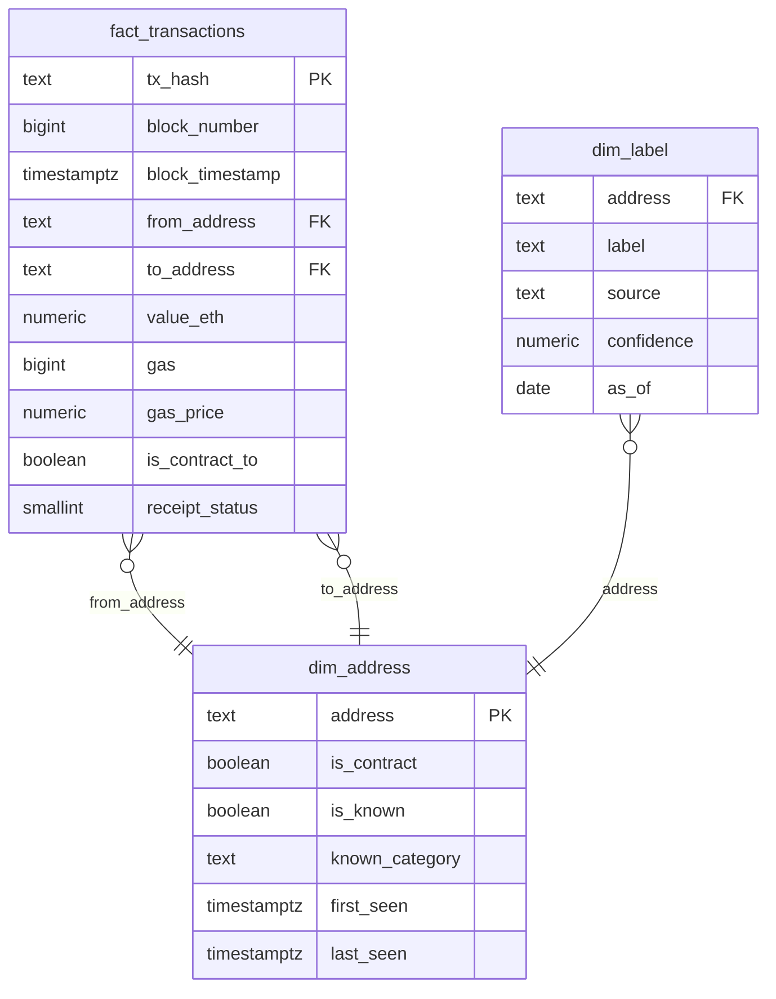

# ChainLens

ChainLens is an Ethereum wallet risk-scoring pipeline built as a four-student
university project. It turns Ethereum transaction data into wallet-level
features, graph signals, rule-based risk scores and an auditable score trace.
Phase 1 delivered the reproducible foundation (Postgres 16 + Neo4j 5,
schema contracts, synthetic fixtures and CI). Phase 2 adds the bounded data
ingestion path, three real label sources, known-address curation, a leakage-safe
address split and canonical `transactions_clean.parquet` output for Phases 3–6.
Phase 3 adds one-row-per-address raw features and a train-only scaler with
content-hash provenance. Phase 4 adds DBSCAN clustering, SCC-first short-cycle
detection, fan-out, sanctioned 1-hop, PageRank, train-only Apriori mining, a
curated Neo4j showcase subgraph and a Streamlit shell. Phase 5 applies the
locked R1–R5 deck weights, writes current `risk_scores`, and persists an
immutable, reconstructable `score_trace` per `(address, rules_version)`.

> **Do not run `make sample` after Phase 2 ingestion.** It truncates and
> reloads `labels`, `label_splits` and `known_addresses` with synthetic fixture
> rows. Use `make ingest` / `make ingest-local` from here on.

## Prerequisites

- Docker Engine or Docker Desktop with Compose v2 (`docker compose version`).
- GNU Make (Linux/macOS) or a shell where `make` is available.
- **Windows:** use WSL2 and run every command from the WSL2 shell. Docker
  Desktop must have WSL2 integration enabled for that distribution.
- No host Python installation is needed for the happy path: Python 3.11 and all
  dependencies live in the `app` container, installed with
  [uv](https://docs.astral.sh/uv/). Host Python 3.11 + uv is only needed for
  `*-local` targets and CI.

## Quickstart (fixture mode, no cloud)

```bash
cp .env.example .env
# Edit .env: set POSTGRES_PASSWORD and NEO4J_PASSWORD.
make up                         # build app image, start DBs, wait for health
make doctor                     # env + Neo4j secret sync + DB connectivity
CHAINLENS_SAMPLE_MODE=1 make sample    # fresh clone only: synthetic fixtures
CHAINLENS_SAMPLE_MODE=1 make overlap   # window gate; writes the decision
CHAINLENS_SAMPLE_MODE=1 make ingest    # labels -> known -> split -> clean
CHAINLENS_SAMPLE_MODE=1 make features  # raw features + train-only scaler
CHAINLENS_SAMPLE_MODE=1 make detect    # DBSCAN -> graph -> Apriori -> seed scores
CHAINLENS_SAMPLE_MODE=1 make score     # locked R1-R5 scores + audit traces
make score-check                       # coverage/version/unscored postconditions
make baseline                          # Phase 6 baseline snapshot
make ablate                            # per-rule isolation evidence
make star-schema                       # optional one-off reporting schema
make graph-load                        # optional Neo4j showcase subgraph
make app                               # Streamlit on http://localhost:8501
CHAINLENS_SAMPLE_MODE=1 make test      # pytest in the app container
make lint                              # ruff check in the app container
```

`make app` is a long-running foreground process; open
<http://localhost:8501> while it runs. The graph tab uses NetworkX and keeps
working if Neo4j is stopped.

`CHAINLENS_SAMPLE_MODE=1` is explicit: real runs never silently fall back to the
synthetic Parquet. CI uses the same flag in `.github/workflows/ci.yml`.

## Phase 2 window decision

Candidate window: **blocks 19,000,000–19,045,000 inclusive** (45,001 blocks,
about one week at 12-second blocks). Block numbers were chosen instead of
timestamps so the export is reproducible.

The overlap gate (`pipeline/00_overlap.py`) counts distinct labeled addresses
touched in-window and compares them with `window.fallback_min_positives: 50`.
The fixture run found **0 of the real labeled addresses** in the synthetic
window (expected: Phase 1 fixture addresses and real label snapshots are
disjoint), so the decision recorded in `data_manifest` and
`data/processed/window_decision.json` is:

```text
labeled_addresses_found = 0
fallback_min_positives = 50
previous_mode = time
mode = label_anchored
```

`config/data.yaml` is updated to `mode: label_anchored`. A live BigQuery overlap
check was **not** run here because no GCP credentials were available in this
environment; no export was executed. Re-run `make overlap` with credentials
before the real export. In label-anchored mode
`pipeline/bigquery_export.sql` selects the label seeds plus 1–2 hop neighbours
inside a wider reference range, then exports only transactions touching that
address set.

## BigQuery pre-flight and manual export

The BigQuery export is a **one-off, manually gated** operation. The runtime
pipeline (Phases 3–6) never imports `google-cloud-bigquery` and never needs a
cloud connection.

```bash
# 1. Build the optional BigQuery client into the app image.
INSTALL_BIGQUERY=1 make up

# 2. Dry run the exact committed SQL. No table scan is executed.
make preflight                 # respects BQ_MAX_BYTES, default 1 TiB

# 3. Only if the dry run passes, run the export manually and download:
#    gs://YOUR_BUCKET/chainlens/transactions-*.parquet
#    gs://YOUR_BUCKET/chainlens/contracts-*.parquet
#    -> data/raw/transactions.parquet
#    -> data/raw/contracts.parquet

# 4. Ingest the real files (no CHAINLENS_SAMPLE_MODE).
make ingest
```

`00_preflight.py` uses `QueryJobConfig(dry_run=True, use_query_cache=False)`,
prints `total_bytes_processed`, the estimated USD at **$6.25/TiB**, and the
remaining **1 TiB/month** free-tier headroom. If the estimate exceeds
`BQ_MAX_BYTES` (default `1099511627776`), it exits non-zero and writes **no
manifest row**; the export must not run. On success it records bytes, USD and
headroom in `data_manifest` before any export.

**Dry-run estimate:** not available in this sandbox because no Google Cloud
credentials are present; `make preflight` exits with “PREFLIGHT NOT RUN” and
writes nothing. The cost/refusal math and the dry-run call are covered by
`tests/test_preflight.py`. Run the preflight with real credentials before the
one-off export and record whether it fits the 1 TiB free tier.

## Label sources and snapshot dates

Committed, offline snapshots live in `data/labels/` with provenance in
`data/labels/SOURCES.json`:

| Source | Label | Snapshot / `as_of` | Confidence | Rows loaded |
|---|---|---|---|---|
| OFAC SDN (brave-intl ETH list) | `sanctioned` | **2026-09-30** (lists branch commit `2026-09-30T14:42:59Z`) | 1.0 | 120 |
| MyEtherWallet darklist | `darklist` | **2020-11-18** (commit `b4f9717…`) | 0.8 | 652 unique |
| Kaggle Ethereum Fraud Detection (Vagif Aliyev) | `fraud` | **2021-01-03** (publication) | 0.9 | 2,174 unique positives |

All addresses are lowercased and validated against `^0x[0-9a-f]{40}$`;
duplicates are collapsed on `(address, source, label)`. Conflicting labels from
different sources are intentionally kept as separate rows. Sanctions are
snapshot-based, not permanent: the 2025 Tornado Cash delisting is why `as_of`
is stored and quoted in evaluation.

## Leakage-safe split

`pipeline/01_ingest.py split` splits **addresses, never transactions**:
stratified by the highest-priority `(source, label)` stratum, `seed=42`,
`test_size=0.3`. All labeled addresses receive a `label_splits` row, train and
test are disjoint, and coverage is repaired deterministically if a source with
≥2 positives would otherwise miss the test split. The summary is written to
`data/processed/split_summary.json` and `data_manifest`.

Rules remain leakage-safe downstream: R3 may only use **train** sanctioned
addresses as seeds, R5 Apriori trains on **train** only, and evaluation uses
**test** only (excluding labels used to fire a rule on the same address).

## Phase 3 address features and scaler provenance

Build features in fixture or real mode (same SQL and code; only the input path
and the fixture-label backfill differ):

```bash
CHAINLENS_SAMPLE_MODE=1 make features   # fixture path
make features                           # real path (requires real Phase 2 output)
CHAINLENS_SAMPLE_MODE=1 make features-check
```

`make features-local` / `make features-check-local` are the host-Python variants
used by CI. The feature build never reads `flagged`; labels stay in `labels` and
`label_splits`.

### Contract-coverage pre-flight

Phase 2 reported one contract in `known_addresses` and five contract-receiving
rows in `transactions_clean.parquet`. Those five rows are **one distinct
contract address**, so coverage was **verified, no gap** (1 distinct contract,
1 known, 0 backfilled). `ensure_contract_coverage` compares the contract source
with `known_addresses` before writing features and, if a real run ever finds a
gap, inserts the missing contract addresses and logs the fix.

### Fixture-label backfill

Sample mode appends exactly three labels with `source='fixture'` and fixed
splits: `SANCTIONED_SEED=train`, `DARKLIST_EXTRA=train`, `KAGGLE_FRAUD=test`.
The insert is `ON CONFLICT DO NOTHING` and the placements are asserted, so
re-runs stay idempotent. Real mode is a strict no-op on `labels` and
`label_splits`; it reads the fixture count and refuses to run if sample labels
are still present (re-run Phase 2 ingest in that case).

### Raw features

`chainlens.features.build_raw_features` is **one DuckDB statement** over
`data/processed/transactions_clean.parquet`. The address universe is the union
of senders and receivers, so pure receivers get a row. Accounting values stay
`DECIMAL` inside DuckDB; no code re-parses raw wei. The fixture build produces
**377 rows / 377 distinct addresses**.

| Feature | Definition |
|---|---|
| `tx_count_out`, `tx_count_in`, `tx_count_total` | Outbound, inbound and total transaction counts |
| `unique_counterparties` | Distinct addresses on the other side of any transaction |
| `fanout_ratio` | `unique_counterparties / NULLIF(tx_count_out, 0)` |
| `total_value_eth`, `median_value_eth` | ETH value sums and medians |
| `round_number_ratio` | Fraction of values at round ETH amounts |
| `net_flow_eth` | Inbound minus outbound ETH |
| `first_seen`, `last_seen` | Activity bounds |
| `is_contract`, `token_transfer_count` | Contract flag and optional ERC20 count |

`fanout_ratio` is deliberately **outbound-only**. `FANOUT_WHALE` has 40
outbound transfers to 40 distinct counterparties, so the ratio is exactly
**1.0** (not 40/45). This keeps R2 about outbound behaviour and prevents a
high-inbound wallet from suppressing its own fan-out signal. R2 uses the raw
counts as its primary test, with `fanout_ratio >= 0.5` as a diversity guard.

### Train-only scaler

The scaler fits the **mean on addresses in `label_splits.split='train'`** and
then applies the transform to every address. Fitting on all addresses would
leak the test distribution into training-time features and make Phase 6's
precision/recall meaningless.

The variance rule is deliberately conservative:

1. Fit the train mean.
2. Fit the train standard deviation.
3. If train std is zero **but full-data std is positive**, use the full-data
   std and record `fitted_on_split='train_fallback_full_std'`.
4. Drop a feature only when its full-data std is zero.
5. Never apply an epsilon floor. Dividing by `1e-6` would inflate scaled values
   by orders of magnitude and break DBSCAN.

Phase 4 discovers the surviving `_scaled` columns dynamically from
`feature_scaler WHERE std > 0`; it does not hard-code a feature list. If a
column is missing it raises a named error with the missing feature and
`scaler_version` instead of silently using fewer features.

| Feature | Transform |
|---|---|
| `total_value_eth`, `tx_count_out`, `tx_count_in`, `unique_counterparties` | `log1p` then standardisation (`log1p_std`) |
| `fanout_ratio` | Standardisation directly (`std`) |
| `net_flow_eth` | **raw** (not in the locked scaled-column list) |

Fixture outcome after the Phase 3 defect fix:

- `token_transfer_count` is dropped (`zero_variance`; full-data std is zero).
- `tx_count_in` is retained via `train_fallback_full_std`: the two train
  addresses both have zero inbound count, but the full fixture has variance.
- `fanout_ratio` also uses `train_fallback_full_std` because both train values
  are exactly 1.0 while the full data varies.
- The fixture scaler has **5 rows**, `row_count=2`, and
  `scaler_version=177dbaf33be2`. Every `address_features` row carries that
  version. Phase 5 chains from it: with the committed Phase 5 `rules.yaml`,
  `rules_version=3e96aa94e670`.

### Evaluable positives and EDA

`make features-check` prints the provenance and the **test-split
feature-bearing label count**: test-split addresses present in
`address_features` with at least one transaction. The fixture value is **1**
(`KAGGLE_FRAUD`, source `fixture`). That is a fixture target, not a real
positive: Phase 6's real evaluable count is **0** because the label source is
`fixture`. The read-only notebook `notebooks/01_eda_features.ipynb` shows
raw/scaled distributions, skew before and after `log1p`, train class balance by
source, dropped features and the same count. It is committed with outputs
cleared.

Two consecutive builds produce the same `scaler_version` and identical
`address_features` content. The run summary, including contract coverage and
dropped features, is written to `data/processed/features_summary.json`.

## Phase 4 detection signals

```bash
CHAINLENS_SAMPLE_MODE=1 make detect   # DBSCAN -> graph -> Apriori -> seed scores
make graph-load                       # optional Neo4j showcase mirror
make graph-reset                      # delete only :ChainLens nodes/relationships
make app                              # Streamlit shell, port 8501
```

`make detect` is idempotent. Each stage deletes only its own signal names from
`address_flags` and rewrites them; two runs produce identical content after
sorting by `(address, signal_name)`. Detection never writes real
`risk_scores`; it only leaves the clearly marked Phase 4 placeholder seed,
which Phase 5 removes before real scoring.

### Signal dictionary

All rows live in `address_flags(address, signal_name, signal_value, evidence)`.
The allowed signal names are `dbscan_cluster`, `dbscan_noise`, `pagerank`,
`pagerank_top5`, `cycle_member`, `fanout`, `sanctioned_1hop`,
`louvain_community` and `apriori_match`.

| Signal | Meaning | Evidence fields | Consumer |
|---|---|---|---|
| `dbscan_cluster` | DBSCAN cluster id, `-1` for noise | `eps`, `min_samples`, `scaler_version` | Phase 5 signal input; no standalone verdict |
| `dbscan_noise` | `1` when the address is DBSCAN noise | `reason` | Optional Phase 5 input; **not** evidence of wrongdoing |
| `pagerank` | Raw weighted PageRank for every node | `pagerank` | R4 input |
| `pagerank_top5` | `1` above the 95th percentile | `pagerank`, `threshold` | R4 |
| `cycle_member` | Address appears in a qualifying short cycle | `cycle_path`, `edge_values`, `time_span_hours`, `scc_size`, `cycles` | R1 |
| `fanout` | Raw outbound fan-out | `unique_counterparties`, `tx_count_out`, `fanout_ratio` | R2 |
| `sanctioned_1hop` | In/out neighbour of a train-split sanctioned seed | `seed`, `direction`, `seed_source`, `seeds`, `directions` | R3 |
| `louvain_community` | Display community id | `community_size` | **Display only** |
| `apriori_match` | Profile matches a train-mined antecedent | `antecedent`, `support`, `confidence`, `lift` | R5 |

### R1: SCC-first short cycles

The graph is an aggregated directed `networkx.DiGraph`: nodes are every address
in `address_features`; edges are one row per `(from, to)` pair with `tx_count`,
`total_value_eth`, `first_tx_ts` and `last_tx_ts`. Zero-value edges are kept for
topology, but a cycle containing a zero-value edge cannot pass value matching.
Self-loops are excluded.

Cycle search is SCC-first, never Johnson's algorithm on the full graph:

1. Compute strongly connected components.
2. Discard SCCs with fewer than 3 nodes.
3. Search `simple_cycles` with `length_bound=5` and cap enumeration per SCC.
4. Keep cycles of length **3–5** only.
5. Require `max(edge_value) / min(edge_value) <= 1.05` (5% tolerance).
6. Require the cycle's earliest-to-latest transaction span to be **≤ 24h**.
7. Cap qualifying cycles at 1,000 per SCC.

The value and time constraints are part of R1. Without them, ordinary refunds
and change-address loops look like wash trading. The current
`address_flags` primary key is `(address, signal_name)`, so R1 writes one row
per address and puts every qualifying cycle in `evidence.cycles`; this is a
schema-safe deviation from the prompt's “one row per cycle” wording.

### R2: raw outbound fan-out

R2 fires when:

```text
unique_counterparties >= 20
AND tx_count_out >= 20
AND fanout_ratio >= 0.5
```

`fanout_ratio` is unique counterparties divided by **outbound** transaction
count. The raw-count test is primary; the ratio is a diversity guard.

### R3: train-split sanctioned seeds only

R3 seeds come from `labels.label='sanctioned'` joined to
`label_splits.split='train'`. Test-split sanctioned addresses are never seeds,
and the seed itself is never flagged by `sanctioned_1hop` (it is already
labeled). Both in- and out-neighbours within one hop are flagged. Fixture:
`SANCTIONED_1HOP` is flagged with seed `SANCTIONED_SEED`; `SANCTIONED_SEED` is
in the train split.

### R4: weighted PageRank

PageRank uses `alpha=0.85`, `weight='total_value_eth'`, `max_iter=100` and
`tol=1e-6`. `pagerank_top5` marks nodes at or above the 95th percentile of raw
PageRank. Fixture: 19 of 377 nodes are in the top 5%; `EXCHANGE_HOT` ranks 2.

### R5: train-only Apriori

Apriori discretises features into boolean items (`high_fanout`,
`high_tx_count`, `low_value`, `high_value`, `many_round`, `is_contract`,
`recent_account`, `high_pagerank`). The consequent is exactly `flagged`.
Mining uses `min_support=0.05` and `min_lift=2.0`.

The mining table is built from the **train split only**. Test-split addresses
are excluded from it entirely, not included with `flagged=False`, so the
absence of a flag cannot leak test labels. Rule matching uses a separate
all-address boolean profile (test labels still blanked), so R5 can be evaluated
on test addresses without training on them. In fixture mode there are only two
train labeled addresses, so Apriori honestly produces **zero rules**; the
wrapper is covered by a synthetic hand-built boolean table with a known
frequent itemset.

### Louvain is display-only

`louvain_community` is computed with `seed=42` and exists to colour the graph
view. It is not in `config/rules.yaml` and must never contribute to scoring.
The test suite greps `rules.yaml` to assert this.

### DBSCAN

Only addresses with `tx_count_total >= 3` are eligible (216 in the fixture
build). The feature matrix is built from the dynamically discovered
`_scaled` columns. `config/detection.yaml` records the knee-derived
`eps=3.195323` and `min_samples=5`; the diagnostic notebook is
`notebooks/02_dbscan_tuning.ipynb` (outputs cleared). The fixture run produces
2 clusters and 11 noise addresses. Noise is not a verdict.

### Curated Neo4j showcase subgraph

Neo4j is a **showcase layer, never a dependency**. `make graph-load` loads only:

- the top 200 addresses by `risk_scores.score DESC`;
- every labeled address (train and test);
- every address with `sanctioned_1hop`, `cycle_member` or `fanout`;
- 1–2 hops of expansion, capped at **2,000 nodes**;
- one aggregated `SENT` relationship per address pair.

The loader tags nodes `:ChainLens`, deletes only that tag on reload, and is
idempotent. The fixture load was re-run twice with **352 nodes / 851
relationships** and no node-cap hit. It never loads the full window. If Neo4j
is down, `make graph-load` fails with a clear message, but `make detect` is
unaffected.

### Streamlit shell

The analyst page (`app/pages/3_Analyst_Dashboard.py`, formerly
`app/streamlit_app.py`) has three tabs:

1. **Ranked list** — `risk_scores` joined to features and flags, sorted by score
   then transaction count, with tier/score/signal filters.
2. **Wallet breakdown** — raw features, pretty-printed flag evidence, and the
   persisted Phase 5 per-rule score trace, including downweight and clamp state.
3. **Graph view** — a NetworkX 1–2 hop neighbourhood capped at 200 nodes,
   rendered with `streamlit-agraph`. Nodes are coloured by tier or Louvain
   community; edge width scales with aggregated `tx_count`.

The graph tab **does not import or require Neo4j**. It was verified with the
Neo4j container stopped. The graph is cached by `scaler_version` plus clean
Parquet mtime so widget interaction does not rebuild it.

### Placeholder scores during Phase 4

`pipeline/04b_seed_scores.py` inserts one row per address in
`address_features` with:

```text
raw_score = 0, score = 0, tier = 'unscored',
rules_version = 'seed-phase4', top_driver = NULL
```

The fixture seed has **377 rows**. Phase 5 deletes every
`rules_version='seed-phase4'` row in a transaction and asserts that no
`tier='unscored'` row survives before writing real scores. The Phase 4 seed
therefore cannot be mistaken for a scored result after `make score`.

### Evaluation fallback

No Google Cloud credentials were available, so the real export and real
positive set remain blocked. Phase 6 reports fixture ablation and states
honestly that there are **zero real evaluable positives and therefore
insufficient data for a meaningful F1**. The only test-split fixture label is
`KAGGLE_FRAUD`, and its `source='fixture'`; it is never counted as a real
positive in evaluation-facing code.

## Phase 5 locked rule scoring and audit trace

```bash
CHAINLENS_SAMPLE_MODE=1 make score   # fixture path
make score                           # real path (requires real Phase 2/3/4 output)
make score-check                     # coverage, version and unscored postconditions
make score-local                     # host-Python variant used by CI
```

Scoring reads PostgreSQL only. It does **not** read Neo4j, recompute graph
signals, or read labels for rule weights. The rule engine loops over the five
rules and evaluates each as a pandas Series; it never loops per address to
decide hits.

### Locked deck rules

Weights are locked. Do not add R6 or change these weights in Phase 5.

| Rule | Weight | Hit condition | Evidence source |
|---|---:|---|---|
| R1 `circular_flow` | **25** | `cycle_member` exists and `signal_value ∈ [3, 5]` | `address_flags.evidence.cycles` |
| R2 `fanout` | **20** | `fanout` exists (unique ≥20, outbound ≥20, ratio ≥0.5) | `address_flags.evidence` |
| R3 `sanctioned_1hop` | **30** | `sanctioned_1hop` exists | `address_flags.evidence` (train seed/direction) |
| R4 `pagerank_top5pct` | **15** | `pagerank_top5` exists with `signal_value = 1` | `address_flags.evidence` (PageRank/threshold) |
| R5 `apriori_match` | **20** | `apriori_match` exists | `address_flags.evidence` (antecedent/support/confidence/lift) |

A rule contributes its full weight at most once. Multiple cycles do not stack;
multiple Apriori matches do not stack. Rule order is R1–R5 and is the
tie-break order for `top_driver`.

### Score arithmetic and tiers

```text
raw_score          = sum(R1..R5 contributions)                  # 0..110
factor             = 0.3 for known exchange/bridge/mixer/contract, else 1.0
adjusted_raw_score = raw_score * factor
clamped            = adjusted_raw_score > max_score
score              = max_score if clamped else int(round(adjusted_raw_score))
tier               = low / medium / high from score
```

`raw_score` is stored unadjusted and may exceed 100.
`adjusted_raw_score` is stored only in the trace. Tiers are based on the final
`score`, never `raw_score`.

| Tier | Final score |
|---|---|
| `low` | 0–24 |
| `medium` | 25–59 |
| `high` | 60–100 |

Tier rationale: R1 alone (25) is medium; R2 alone (20) is low; R3 alone (30) is
medium; R1+R2+R3 (75) is high; all five rules (110) clamp to 100 and stay high.
This preserves the deck's severity ordering without reweighting.

Python's `round()` uses banker's rounding: **10.5 → 10**, not 11. The downside
is intentional and documented so the exchange downweight example is stable.

### Downweight and hard clamp

Known addresses in `known_addresses` whose category is `exchange`, `bridge`,
`mixer` or `contract` multiply the raw score by **0.3** before clamping. This
keeps exchange hot wallets from flooding the top of the ranked list while
still preserving their raw evidence in the trace.

Clamping is a **hard clamp** at `max_score` (100 in the locked config).
`score_trace.clamped` records saturation. There is no proportional
normalization: normalizing would hide saturation and change the
interpretability story. `max_score` is read at runtime; a config with a lower
value clamps to that value.

### Seed scoring policy is deck-pure

`SANCTIONED_SEED` scores **0** under v0. R3 is a **1-hop** rule: it flags
neighbours of a train-split sanctioned seed, not the seed itself. The seed is
ground truth, not a detection target. Phase 6 does not treat seeds or unlabeled
signal-bearing addresses as positives; the ranked list is descriptive and the
ablation is a detection test. There is deliberately no direct-label scoring
rule.

### `rules_version` composition

```text
rules_version = sha256(raw_rules_yaml_text + "|" + scaler_version)[:12]
```

The raw YAML text is hashed, so comments and whitespace changes produce a new
version. A new scaler version also produces a new `rules_version`. The human
label `v0-deck` is stored separately as `rules_version_label`; it is not the
database provenance key.

The fixture values are:

```text
rules_version       = 3e96aa94e670
rules_version_label = v0-deck
scaler_version      = 177dbaf33be2
engine_version      = phase5-v1
```

### Trace contract

`score_trace.trace` is self-contained JSON. Every address has exactly R1–R5,
including rules that did not fire:

- non-hit rules have `hit: false`, `contribution: 0`, and **`inputs: null`**;
  they never use `{}` or fabricated zeros;
- hit rules copy the Phase 4 `address_flags.evidence`, do not recompute it;
- `sum(rules[*].contribution) == raw_score`;
- `adjusted_raw_score == raw_score * downweight.factor`;
- `score` and `clamped` follow the arithmetic above;
- `downweight` records `applied`, `category`, `factor`,
  `pre_downweight_raw` and `post_downweight_raw`;
- `top_driver` is the largest contribution, tie-broken by R1–R5 order, or
  `null` when nothing fired;
- R1 `inputs.cycles` is capped at **5** cycles. If more existed,
  `trace.truncated = true` and `cycle_count` keeps the true count;
- long string fields are capped at 1,000 characters.

`risk_scores` is the **current** view: one row per address, overwritten on a
re-score. `score_trace` is **history**: the primary key is
`(address, rules_version)`, so old versions remain available. Re-running
`make score` with the same rules/scaler/evidence is content-idempotent:
`risk_scores` content is identical and `score_trace` has no duplicate rows.
`evaluated_at` is derived from the evidence snapshot (`max(address_flags.created_at)`)
so unchanged evidence produces the same trace content.

### Fixture scores

Computed from the actual fixture flags after Phase 4:

| Fixture | Hit rules | Raw | Final score | Tier |
|---|---|---:|---:|---|
| `CYCLE_A`, `CYCLE_B`, `CYCLE_C` | R1 | 25 | **25** | medium |
| `SANCTIONED_1HOP` | R3 | 30 | **30** | medium |
| `FANOUT_WHALE` | R2 (+R4 if `pagerank_top5`) | 20 or 35 | **20 or 35** | low or medium |
| `EXCHANGE_HOT` | R2+R4, known `exchange` | 35 | **10** (35 × 0.3 = 10.5 → 10) | low |
| `CLEAN_USER_1..10` | none | 0 | **0** | low |
| `SANCTIONED_SEED` | none (deck-pure seed) | 0 | **0** | low |
| `KAGGLE_FRAUD` | whatever flags exist | — | — | — |

In the fixture run `EXCHANGE_HOT` ranks **25th** by final score, so it is not in
the top 10. The top 10 is led by the two R3 1-hop addresses (30), the three R1
cycle addresses (25), `FANOUT_WHALE` (20), then R4-only addresses (15).
`FANOUT_WHALE` has no `pagerank_top5` flag in this run, so its score is **20**.

The scoring summary is written to `data/processed/score_summary.json` and
printed to stdout. Top-level keys include `rules_version`,
`rules_version_label`, `scaler_version`, `engine_version`, `counts_by_tier`,
`counts_by_top_driver`, `top_10`, `exchange_hot`, `clamped_count`,
`downweighted_count`, `seed_rows_deleted`, and `unscored_after`.

## Phase 6 evaluation, baseline and ablation

Phase 6 closes the project with an honest evaluation, a per-rule ablation
detection test, a decision-tree feature-importance exhibit, a finished
Streamlit dashboard, a small reporting star schema, and a clean-clone demo
path. No rule was added or reweighted.

### Honest positive disclosure

The Phase 6 evaluable-positive definition is **test-split addresses present in
`address_features` with `source != 'fixture'`**. The current fixture state is:

| Quantity | Count |
|---|---:|
| Test-split labeled addresses | 889 |
| Test-split labels present in `address_features` | 1 |
| Of those, `source='fixture'` (`KAGGLE_FRAUD`) | 1 |
| **Real evaluable positives (`source != 'fixture'`)** | **0** |

The brief's locked `n=1` is the fixture target, not a real positive. The
fixture target is disclosed separately and is **never** counted in a metric.
`notebooks/03_evaluation.ipynb` therefore prints:

```text
real evaluable positives (source != fixture): n=0
fixture test-split labeled addresses (not counted): n=1
F1 = 'insufficient'
```

`chainlens/evaluation.classification_metrics` returns
`{"insufficient": True, "n_positives": n}` for any `n < 3`; it never returns
`1.0` on a one-row fixture. The ranked list still shows `KAGGLE_FRAUD` at rank
30 in a full sort, with its fixture source visible, and `SANCTIONED_SEED` at
score 0 to make the deck-pure policy explicit.

### Baseline snapshot

```bash
make baseline
```

The snapshot is `data/processed/score_baseline_3e96aa94e670.parquet` with a
companion summary JSON. Current values:

```text
rules_version       = 3e96aa94e670
rules_version_label = v0-deck
scaler_version      = 177dbaf33be2
engine_version      = phase5-v1
rows                = 377
tier counts         = low 372 / medium 5 / high 0
content_sha256      = 22ac247025a5ba3bc5274ecff7368fc95309d47e8ef4847f8a7b9dc06bc6617a
```

The summary also stores the top 10 and the `EXCHANGE_HOT` trace details. The
snapshot is the restore reference for ablation. The content hash covers every
score and trace field except the volatile `evaluated_at` timestamp, so a
legitimate re-score with identical inputs still satisfies the restore check.

### Per-rule ablation detection test

```bash
make ablate
```

`chainlens/ablation.py` loads the baseline and the current locked rules, makes
an in-memory frozen copy with one weight set to zero, re-runs
`chainlens.rules.evaluate`, and compares every address. The live database and
`config/rules.yaml` are not mutated; the rules file hash is checked again in a
`finally` block. This is stronger than a copy/modify/restore of the live config.

| Rule | Primary target | Baseline raw | Ablated raw | Raw delta | Affected wallets | Other wallets changed |
|---|---|---|---:|---:|---:|---:|---|
| R1 | `CYCLE_A`, `CYCLE_B`, `CYCLE_C` | 25 | 0 | 25 | 3 | False |
| R2 | `FANOUT_WHALE` | 20 | 0 | 20 | 2 | False |
| R3 | `SANCTIONED_1HOP` | 30 | 0 | 30 | 2 | False |
| R4 | `0x2693a1f675837f743d333624873a75ccd3f0e161` (top-ranked `pagerank_top5` in top 10) | 15 | 0 | 15 | 19 | False |
| R5 | Untestable: zero Apriori flags on fixture | — | — | — | 0 | False |

`affected_wallets` counts every wallet that hit the rule. A global rule removal
necessarily changes all of them; **isolation** means no wallet outside that
hit set changed. For R2, the affected set is `FANOUT_WHALE` plus
`EXCHANGE_HOT`; the primary target still loses exactly 20 raw points.

`EXCHANGE_HOT` R2 arithmetic is documented rather than reduced to a single
delta:

```text
baseline:  raw 35  -> 35 × 0.3 = 10.5 -> final 10
ablated:   raw 15  -> (35 − 20) × 0.3 = 4.5 -> final 4
final delta = 6, not the raw 20
```

After the run, `pipeline/07_ablation.py` calls `assert_baseline_restored` and
prints `BASELINE RESTORE OK`; the content hash equals
`22ac247025a5ba3bc5274ecff7368fc95309d47e8ef4847f8a7b9dc06bc6617a`.
R5 is skipped in `tests/test_ablation.py` with the reason that zero Apriori
rules exist on the fixture and the mining wrapper is covered by
`tests/test_apriori.py`.

### Decision-tree exhibit

`notebooks/04_baseline_and_ablation.ipynb` fits
`DecisionTreeClassifier(max_depth=3, random_state=42, class_weight="balanced")`
as an interpretability exhibit, not a performance claim. The split table covers
only three feature-bearing addresses (two train, one test), so the exhibit
trains on **all non-test feature addresses**: the two train labels are
positives and the remaining unlabeled non-test addresses are negatives. The
test-split address is excluded entirely. A literal two-row fit would be
unreadable, and including the test address would leak.

Current tree fit: 376 rows, 2 train positives. Top importances are
`total_value_eth_scaled=0.9986`, `unique_counterparties_scaled=0.0014`, and
three zero-importance features. The train confusion matrix is
`[[364, 10], [0, 2]]`; it is overfit by construction. No test metric is
reported, and the notebook contains no test-set scoring call. The takeaway is
"rules vs learned ordering", not "rules beat/lose to trees": four of the five
rules depend on graph/pattern inputs that are not in the numeric feature matrix.

### Dashboard completion

`app/pages/3_Analyst_Dashboard.py` works with Neo4j stopped:

- tier colours: low grey, medium amber, high red;
- ranked-list rows are click-selectable and jump to the wallet breakdown;
- the wallet tab has a `Full trace (JSON)` expander using `st.json`;
- `Open in Neo4j Browser` is rendered only when `NEO4J_URI` is reachable and
  the address exists as a curated `:ChainLens` node;
- empty states say `No scores yet — run make detect then make score` and
  `Trace not found for rules_version X — re-run make score`.

`make app-local` is available for the host-Python path. The demo-day check is
to stop Neo4j, reload Streamlit, and verify all three tabs still render
(Ranked list, Wallet breakdown, Graph view). The graph tab reads NetworkX.

## Phase 7 operations UI

Phase 7 turns the existing Streamlit shell into a multipage operations console
without changing the pipeline. The analyst dashboard is now
`app/pages/3_Analyst_Dashboard.py` and is byte-for-byte the Phase 6 dashboard.
The landing page is `app/streamlit_app.py`, launched through the thin
`app/Home.py` entrypoint so Streamlit's auto-generated sidebar shows **Home**.

```text
app/
├── Home.py                       # Streamlit entrypoint (sidebar: Home)
├── streamlit_app.py              # landing implementation: state + page links
├── pages/
│   ├── 1_Pipeline.py             # run stages, live output, status strip
│   ├── 2_Data_Explorer.py        # browse all tables, CSV, read-only SQL
│   ├── 3_Analyst_Dashboard.py    # unchanged Phase 6 ranked/wallet/graph tabs
│   ├── 4_Logs.py                 # run history, log tail, rerun
│   └── 5_Admin.py                # health, versions, disk, danger zone
└── components/
    ├── stage_runner.py           # the only module that runs scripts/run.sh
    ├── table_browser.py          # read-only table access + SQL validator
    ├── admin_actions.py          # transactional cleanup actions
    └── status.py                 # pipeline_runs read/write helpers
```

### Using the UI

```bash
make app           # http://localhost:8501
make logs-tail     # newest log; optional STAGE=score
```

Sidebar pages: the landing page, **Pipeline**, **Data Explorer**, **Analyst
Dashboard**, **Logs**, and **Admin**. The sidebar is generated by Streamlit's
`pages/` directory; `make app` and `make app-local` are unchanged.

- **Pipeline** — choose `sample` or `real` per page. Five status cards read the
  latest successful `pipeline_runs` row for that mode; a clock icon means the
  input changed after the run. Buttons enforce the order sample → ingest →
  features → detect → score. Live output is streamed from
  `scripts/run.sh <stage>`; completion shows row counts, elapsed time, the
  `pipeline_runs.id`, and a link to Logs. A force checkbox skips prerequisite
  checks for recovery work, but never permits `sample` in real mode or a sample
  wipe without confirmation.
- **Data Explorer** — all nine operational tables with a static phase filter,
  substring search, column visibility, CSV download, 5,000-row initial cap
  with Show more, `score_trace` JSON viewer, and a read-only SQL box. The SQL
  box accepts one `SELECT`/CTE, rejects comments and write/DDL keywords, and
  executes inside `SET TRANSACTION READ ONLY` before rolling back.
- **Analyst Dashboard** — the same ranked list, wallet breakdown and NetworkX
  graph as Phase 6. Neo4j is still optional.
- **Logs** — the last 50 runs, colour-coded status, log tail (1,000 lines), and
  a rerun button that writes a new row. Admin audit rows are not rerunnable.
- **Admin** — Postgres/Neo4j health, schema and `tx_count_in` checks, version
  chain, baseline hash comparison, disk usage, and typed-confirmation danger
  actions. `config/rules.yaml` restore is deliberately not offered.

### `pipeline_runs`

```sql
CREATE TABLE IF NOT EXISTS pipeline_runs (
    id SERIAL PRIMARY KEY,
    stage TEXT NOT NULL CHECK (stage IN
        ('sample','ingest','features','detect','score','admin')),
    mode TEXT NOT NULL CHECK (mode IN ('sample','real')),
    status TEXT NOT NULL CHECK (status IN ('running','success','failed')),
    started_at TIMESTAMPTZ DEFAULT now(),
    finished_at TIMESTAMPTZ,
    exit_code INTEGER,
    row_counts JSONB,
    version_snapshot JSONB,
    log_path TEXT,
    error TEXT,
    triggered_by TEXT DEFAULT 'ui'
);
```

The table is operational, not analytical: it is intentionally absent from the
star schema. It makes the UI stateless — refresh, restart, or open a second tab
and the state is still there. Every invocation (including blocked/aborted
attempts and Admin actions) writes exactly one row, with `running` updated to
`success`/`failed` in a `finally` block.

### Stage runner safeguards

- Command: `scripts/run.sh <stage>`, never `make <stage>`.
- Timeout: 15 minutes; on timeout the process is killed and the row is `failed`.
- Environment: `CHAINLENS_SAMPLE_MODE=1` for sample runs; unset for real runs.
- Prerequisites: input files for ingest/features; a successful previous stage
  and non-empty `address_features` / `address_flags` for detect/score.
- Blocked attempts are logged as `failed` rows with the blocking reason.
- Logs: `data/logs/{stage}_{mode}_{YYYYmmdd_HHMMSS}.log` (gitignored).

### Safety guardrails

1. Destructive Admin actions require typing `DELETE`, `RESET` or `FIXTURE`.
2. No arbitrary SQL writes: the Data Explorer is read-only.
3. Ablation and notebook logic stay in notebooks; the UI shows results only.
4. Sample mode is visible on the landing, Pipeline, Data Explorer and Admin
   pages; Data Explorer tags fixture rows.
5. Every UI action is logged to `pipeline_runs`.
6. Running `sample` with real labels present is blocked until explicitly
   confirmed; `sample` in real mode is always blocked.

## Star schema (reporting artifact)

`sql/star_schema.sql` adds `fact_transactions`, `dim_address`, and `dim_label`.
`pipeline/07_star_schema.py` is a one-off population script; it is **not** in
the main `make` chain. The pipeline continues to operate on normalised Parquet
and Postgres (`address_features`, `address_flags`, `risk_scores`,
`score_trace`).

```bash
make star-schema
```

Current populated counts: `fact_transactions=970`, `dim_address=377`,
`dim_label=2,949`. The source Parquet has 970 clean rows. The script is
idempotent and records the fact row count in `data_manifest` under
`star_schema:fact_transactions`.



The star schema is a **reporting view that backs the warehousing claim**. It is
not on the critical path, and no module in `chainlens/` or `pipeline/` imports
the fact table. `tests/test_star_schema.py` applies the DDL twice, checks the
population count against the Parquet, and greps for any import of
`fact_transactions`.

## Limitations

- The fixture has **zero real evaluable positives**; the brief's `n=1` is one
  test-split fixture label (`KAGGLE_FRAUD`), so `F1`, precision, recall and
  PR-AUC are reported as `"insufficient"`, never as `1.0`.
- `net_flow_eth` is window net flow, not a wallet balance.
- Internal transactions (`traces`) are not captured; a wallet's true activity
  is undercounted.
- Sanction-list snapshots are 2020-11-18 (darklist), 2021-01-03 (Kaggle), and
  2026-09-30 (OFAC); list contents change.
- The `high` tier is untested on fixture: zero wallets fire three or more rules.
- R5 Apriori is tested synthetically only; the fixture has zero mined rules.
- The analysis window is bounded to one week and a pinned block range.
- Exchange/contract downweight is a single-factor heuristic (`0.3`), not
  calibrated against outcomes.

## Ethics

A risk score is a heuristic signal, not evidence of wrongdoing. The label
sources (OFAC SDN, darklist, Kaggle) carry their own terms of use; this project
uses them for evaluation, not accusation. No address-to-entity attribution is
performed: a high score flags an address for human review, not a person.

## Deck reconciliation

Slides 13–14 of the deck describe Neo4j with GDS and Etherscan for ingestion.
The implementation uses NetworkX for algorithms (GDS is not available on the
free tier of Neo4j Aura, and GDS is not needed for a bounded window) and
replaces Etherscan labels with OFAC, darklist, and Kaggle, because Etherscan
does not provide ground-truth labels. Neo4j remains in the stack as the
showcase layer for visual graph queries. This change was made during Phase 2
for cost and evaluation reasons.

## Version chain

| Field | Value |
|---|---|
| `rules_version` | `3e96aa94e670` |
| `rules_version_label` | `v0-deck` |
| `scaler_version` | `177dbaf33be2` |
| `engine_version` | `phase5-v1` |
| locked weights | R1 25 / R2 20 / R3 30 / R4 15 / R5 20 |
| `max_score` | 100 |
| tiers | low ≤ 24, medium ≤ 59, high > 59 |
| downweight | 0.3 for exchange / bridge / mixer / contract |

## Demo script

```bash
# Fresh clone
cp .env.example .env             # set POSTGRES_PASSWORD and NEO4J_PASSWORD
make up
CHAINLENS_SAMPLE_MODE=1 make sample
CHAINLENS_SAMPLE_MODE=1 make overlap
CHAINLENS_SAMPLE_MODE=1 make ingest-local
CHAINLENS_SAMPLE_MODE=1 make features-local
CHAINLENS_SAMPLE_MODE=1 make detect-local
CHAINLENS_SAMPLE_MODE=1 make score-local
make score-check
make app                         # http://localhost:8501

# Phase 6 evidence (optional but recommended before the demo)
make baseline
make ablate
make star-schema

# Neo4j is optional:
make graph-load                 # showcase layer only
```

`make sample` is sample-mode only and must run on a fresh clone before
`ingest`; do not run it in real mode after a real Phase 2 ingest. To prove the
dashboard is not dependent on Neo4j, stop it and reload:

```bash
docker compose stop neo4j
# reload http://localhost:8501: all three tabs must still render
docker compose start neo4j
make graph-load
```

`CHAINLENS_CLEAN_CLONE=1 pytest tests/test_clean_clone.py` runs the scripted
clean-clone chain as a manual gate. It is skipped by default so ordinary test
runs do not truncate sample data.

Clean-clone verification was performed on 2026-10-22 from a source copy with
fresh Postgres/Neo4j volumes, no `.env`, and no `data/processed` directory. The
full chain was `make up` → `make sample` → `make overlap` → `make ingest-local`
→ `make features-local` → `make detect-local` → `make score-local` →
`make baseline-local` → `make ablate-local` → `make star-schema-local`. Results:
`109 passed, 3 skipped` on two consecutive pytest runs, `ruff check .` clean,
all three dashboard tabs rendered with Neo4j stopped, and the optional Neo4j
link appeared after restart plus `make graph-load`. The baseline content hash
`22ac247025a5ba3bc5274ecff7368fc95309d47e8ef4847f8a7b9dc06bc6617a` reproduced in
the clean clone.

## Data and manifest contracts

- `data/raw/` — real BigQuery Parquet drops (gitignored; empty in fixture mode).
- `data/processed/` — generated by Phase 2/3 (gitignored):
  - `transactions_clean.parquet` is the single source of truth for Phases 3–5.
  - `labels_snapshot.parquet`, `split_summary.json`,
    `known_addresses_summary.json`, `window_decision.json`.
  - `features_summary.json` records scaler rows/version, dropped features,
    contract coverage and the expected evaluable-positive count.
- `data/sample/transactions.parquet` — Phase 1 synthetic fixtures (committed).
- `data/logs/` — Phase 7 stage logs (gitignored; created on first run).
- `sql/schema.sql` — plain SQL DDL, no ORM. Phase 7 adds the operational
  `pipeline_runs` table. Phase 2 adds nullable
  `bytes_processed`, `estimated_usd` and `metadata` columns to `data_manifest`
  via idempotent `ALTER TABLE ... ADD COLUMN IF NOT EXISTS`. Phase 3 adds
  `address_features.tx_count_total`, `address_features.scaler_version`,
  `feature_scaler` and `feature_scaler_dropped` the same way.
- `address_features` still has **no `flagged` column**; labels remain only in
  `labels` / `label_splits`.

`transactions_clean.parquet` is produced by DuckDB: `receipt_status = 1` only,
self-transfers dropped, addresses lowercased, contracts flagged on the receiving
side, and wei converted with HUGEINT quotient/remainder into
`DECIMAL(38,18)` — never pandas `int64`/`float64`.

## Shared execution entrypoint

`scripts/run.sh` is the single pipeline entrypoint. It detects whether it is
inside the app container (`/.dockerenv`) and chooses `python` or
`docker compose exec -T app python`; `CHAINLENS_RUNNER=local` forces host Python
for CI. The stage commands (`labels`, `known`, `split`, `clean`, `ingest`,
`features`, `features-check`, `cluster`, `graph`, `apriori`, `seed-scores`,
`detect`, `score`, `score-check`, `baseline`, `ablate`, `star-schema`,
`graph-load`, `graph-reset`, `app`, `overlap`, `preflight`, `doctor`) are
written once.

## Make targets

| Target | Runs where | Purpose |
|---|---|---|
| `make up` | host | Build app image and start services with health waits |
| `make down` | host | Stop containers, preserve named volumes |
| `make doctor` | app container | Env, Neo4j secret sync, Postgres + Neo4j checks |
| `make overlap` | app container | Label-overlap gate; updates `window.mode` |
| `make preflight` | app container | BigQuery dry-run cost gate (manual) |
| `make ingest` | app container | labels → known → split → clean |
| `make features` | app container | raw features → train-only scaler → `address_features` |
| `make features-check` | app container | provenance, dropped features, evaluable positives |
| `make detect` | app container | DBSCAN → graph → Apriori → placeholder score seed |
| `make score` | app container | locked R1–R5 scores → `risk_scores` + `score_trace` |
| `make score-check` | app container | verify coverage, versions and zero `unscored` rows |
| `make baseline` | app container | write Phase 6 score/trace snapshot + summary |
| `make ablate` | app container | per-rule isolation test and `ablation_report.*` |
| `make star-schema` | app container | one-off populate `fact_transactions` + dims |
| `make graph-load` | app container | idempotent curated Neo4j showcase subgraph |
| `make graph-reset` | app container | delete only `:ChainLens` Neo4j nodes/relationships |
| `make app` | app container | Streamlit operations console on <http://localhost:8501> |
| `make app-local` | host Python | Same Streamlit app for local/CI |
| `make logs-tail` | host | Tail the newest stage log (optional `STAGE=score`) |
| `make schema` | app container | Apply `sql/schema.sql` (idempotent) |
| `make sample` | app container | **Phase 1 only** — do not run after ingestion |
| `make test` / `make lint` | app container | pytest / ruff |
| `make *-local` | host Python | Same actions for CI and local development |
| `make clean` | host | `docker compose down -v` after an explicit warning |

Host setup for `*-local`:

```bash
uv venv --python 3.11
source .venv/bin/activate
uv pip install -r requirements.txt
make doctor-local && make overlap-local && make ingest-local && make features-local \
  && make detect-local && make score-local && make test-local
```

## Ports

| Service | Host port | Purpose |
|---|---|---|
| PostgreSQL 16 | `5432` | labels, splits, known addresses, features, flags, scores, manifest |
| Neo4j 5 HTTP | `7474` | Neo4j Browser |
| Neo4j 5 Bolt | `7687` | Driver connection (`NEO4J_URI`) |
| Streamlit | `8501` | Phase 4 shell (`make app`) |

Neo4j heap/page cache default to `512m` / `1g` / `512m` and are overridable via
`NEO4J_HEAP_INITIAL`, `NEO4J_HEAP_MAX`, `NEO4J_PAGECACHE`.

## Neo4j credentials and Aura

`docker-compose.yml` derives the container credential from the same secret the
driver uses: `NEO4J_AUTH=neo4j/${NEO4J_PASSWORD}`. `make doctor` asserts this
agreement and verifies both databases. Local Docker is the default. To use Aura
Free, set `NEO4J_URI=neo4j+s://…` in `.env` — no code changes are required.
Aura is never a dependency or the default.

## Implementation notes and environment limitations

- No Google Cloud credentials were available in this environment, so the live
  overlap query, real BigQuery dry run and one-off export were not executed.
  The gates and refusal behaviour are implemented and unit-tested; the fixture
  path proves the ingestion/split/clean/feature contracts end to end.
- The fixture scaler is fitted on only **two** train addresses
  (`SANCTIONED_SEED`, `DARKLIST_EXTRA`). It is a provenance/plumbing check, not
  a representative model. `tx_count_in` and `fanout_ratio` use the full-data
  standard-deviation fallback; only `token_transfer_count` is dropped because
  its full-data variance is zero.
- The fixture has **one test-split fixture label** (`KAGGLE_FRAUD`) and **zero**
  real evaluable positives (`source != 'fixture'`), so Phase 6 fixture
  precision/recall has no statistical power. The `n=1` in the brief refers to
  the fixture target, not a real positive; metrics are reported as
  `"insufficient"`.
- Phase 4 Apriori produces **zero rules** in fixture mode: there are only two
  train labeled addresses, below the 5% support floor. The mining wrapper is
  tested with a synthetic frequent itemset instead.
- DBSCAN is a signal, not an anomaly verdict. The fixture run clusters 216
  eligible addresses into 2 clusters plus 11 noise; sparse wallets can be noise
  without being suspicious.
- The sample has no ERC20 transfers, so `token_transfer_count` is zero and was
  dropped as zero-variance. The real path reads an optional token-transfer
  Parquet if one is staged.
- The exchange/bridge/mixer list is a small documented seed
  (`config/known_addresses_seed.json`), not exhaustive. In sample mode Phase 2
  also re-adds the three synthetic fixture known addresses (including
  `EXCHANGE_HOT` as `exchange`) so downstream downweight tests remain faithful.
- The Kaggle fraud labels are historical (published 2021); evaluation must
  quote the snapshot dates and avoid treating them as current ground truth.
- Phase 5 scoring is rule-based and intentionally does not learn weights from
  labels. The only train-only learning remains R5 Apriori and the R3 seed set.
- `rules_version` includes the scaler version but not the flag-generation
  timestamp. Re-running `make detect` with changed evidence but identical rules
  and scaler keeps the same `rules_version` and updates the trace for that
  version; the trace's `evaluated_at` is derived from the evidence snapshot.
