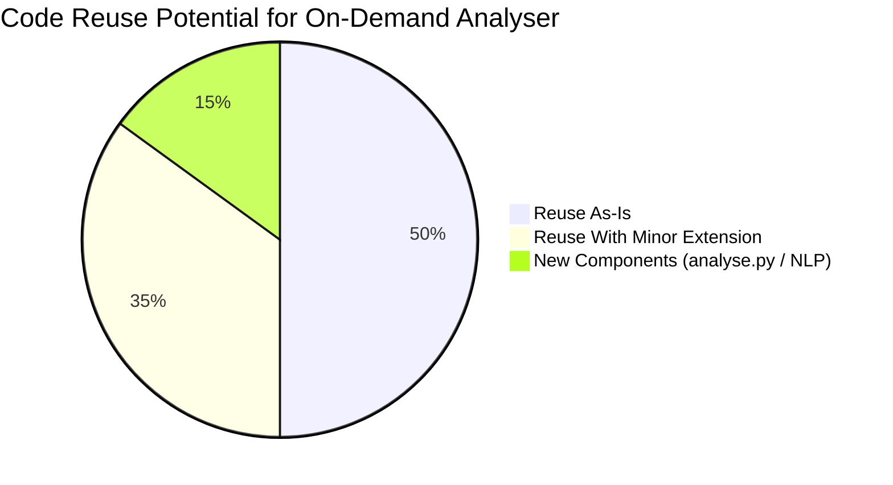
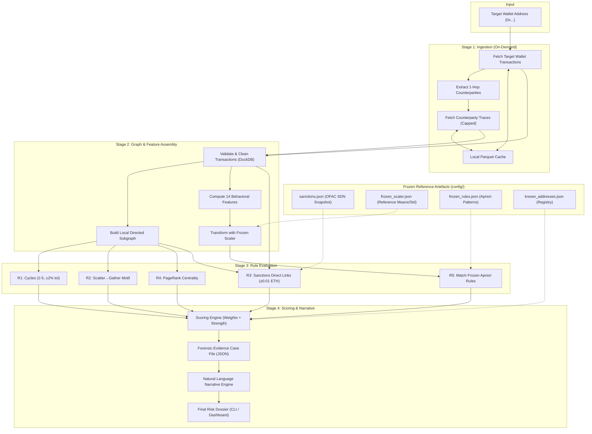

# ChainLens Pivot Analysis: Batch Validator → On-Demand Wallet Analyser

> **Status:** Active Roadmap & Architecture Specification  
> **Repository:** `ChainLens-v2`  
> **Current Pipeline Version:** v2.0.0 (Rules Contract: `v0-deck` with paper-grounded refinements)

---

## 1. What the Project Currently Does

ChainLens currently operates as a **batch forensic pipeline** that ingests a defined cohort of Ethereum addresses, runs 5 paper-grounded detection rules (R1–R5) plus unsupervised methods (DBSCAN, Louvain), computes a composite 0–100 risk score with continuous evidence strength, and evaluates performance against ground-truth labels with P/R/F1 + ablation.

**Key characteristics of the current system:**
- **Storage:** In-memory + persisted DuckDB relational warehouse (`data/output/chainlens.duckdb`) and columnar Parquet tables.
- **Rule Grounding:** R1 captures cycles of length 2–5 within ±2% value tolerance; R2 captures temporal scatter→gather smurfing; R3 checks direct exposure to frozen OFAC sanctions seeds (`config/sanctions.json`) with dust filtering; R4 evaluates continuous value-weighted PageRank above the 90th percentile; R5 mines association rules on training split positives.
- **Explainability:** Generates a comprehensive per-wallet forensic trace JSON capturing exact cycle paths, counterparties, exposure fractions, and percentile rankings.
- **Current Constraint:** The pipeline is orchestrated as a batch run over a pre-selected cohort. The on-demand mode aims to accept an arbitrary wallet address on the fly and produce an immediate explained risk dossier.

---

## 2. Target State: On-Demand Wallet Analyser

> Given **one or more wallet addresses**, fetch on-chain transaction history on demand, build their local ego-subgraph, evaluate the 5 paper rules (R1–R5), and produce an **explained risk case file** showing:
> - The final composite risk score (0–100) and assigned risk tier (High / Medium / Low)
> - Which rules fired, their evidence strength ($s_i \in [0, 1]$), and **how many points each rule contributed**
> - Concrete evidentiary metrics (cycle paths, counterparty dispersion, sanctioned exposure fractions, PageRank percentile)
> - A natural-language narrative: *"R3 (Sanctioned 1-Hop) contributed 30.0 pts: this wallet transacted directly with 0x7f36... (OFAC-sanctioned address), accounting for 100% of its inbound volume."*

---

## 3. Gap Analysis & Current Implementation Status

| Area | Batch Pipeline (Current) | On-Demand Analyser (Required) | Implementation Status |
|---|---|---|---|
| **Entry Point** | Batch CLI (`run.py --mode real/sample`) and `full_runner.py` | Single-wallet CLI (`analyse.py` or `run.py --address 0x...`) & API | ⏳ Needs `analyse.py` entry point |
| **Data Ingestion** | Pre-planned cohort + random context blocks | Target wallet + 1-hop neighbours fetched on demand via `EtherscanClient` | 🟡 Reuses `EtherscanClient`; needs 1-hop neighbor expansion |
| **Feature Engineering** | 14 behavioral features in DuckDB OLAP SQL | Compute features for target wallet + local neighbourhood | ✅ Logic already exists in `features.py` |
| **Feature Scaling** | Fitted dynamically on training split | Use a **frozen scaler** (`frozen_scaler.json`) pre-fitted on a reference population | ⏳ Needs frozen scaler serialization |
| **R1 – Circular Flow** | Tarjan SCC + cycles (length 2–5, ±2% tolerance) | Evaluates on local ego-subgraph around target wallet | ✅ Rule logic complete; runs on any graph |
| **R2 – Scatter–Gather** | 3-gate scatter + 72h gather continuation check | Evaluates on target wallet's outbound transfers and onward edges | ✅ Rule logic complete & per-wallet |
| **R3 – Sanctioned 1-Hop** | Frozen OFAC list (`config/sanctions.json`) + dust gate (≥0.01 ETH) + exposure fraction | Checks neighbours against `config/sanctions.json` | ✅ **Completed & decoupled from split** |
| **R4 – PageRank** | Value-weighted PageRank (α=0.85), continuous tail ≥90th pct, known hub exclusion | Compare against reference threshold or compute on local ego-subgraph | 🟡 Logic complete; needs frozen percentile reference |
| **R5 – Apriori Match** | Mined on training positives, evaluated globally | Match wallet against **frozen association rules** (`frozen_rules.json`) | ⏳ Needs rule export from reference run |
| **Composite Scoring** | Additive sum: $\sum w_i \cdot s_i$, downweighting (0.3×), clamp (0–100) | Identical per-wallet scoring formulation | ✅ **Fully implemented in `scoring.py`** |
| **Forensic Trace** | Detailed per-wallet JSON trace with evidentiary inputs | Add natural-language narrative renderer | 🟡 Trace JSON complete; narrative wrapper needed |
| **Evaluation / Split** | P/R/F1 on test split labels + leave-one-rule-out ablation | Retained for offline benchmark; bypassed in on-demand mode | ✅ Decoupled from core scoring |
| **Dashboard** | 7-tab Streamlit workspace reading Parquet artifacts | Dedicated "Analyse Wallet" search & dossier view | 🟡 Dossier tab exists; needs ad-hoc query input |

---

## 4. Code Reuse Assessment

| Module | Location | Reuse? | Notes |
|---|---|---|---|
| `fetch_data.py` | [`fetch_data.py`](file:///home/codez/Desktop/Chain-Analysis/ChainLens-v2/fetch_data.py) | 🟢 ~85% | `EtherscanClient`, caching, and normalisation are directly reusable. Add neighbour-expansion fetcher. |
| `features.py` | [`features.py`](file:///home/codez/Desktop/Chain-Analysis/ChainLens-v2/features.py) | 🟢 ~90% | Exact DuckDB `DECIMAL(38,18)` calculations reusable. Add frozen scaler application mode. |
| `patterns.py` | [`patterns.py`](file:///home/codez/Desktop/Chain-Analysis/ChainLens-v2/patterns.py) | 🟢 ~85% | R1, R2, R3, R4 paper implementations are already refined and parameterized. R5 needs frozen rule evaluation. |
| `scoring.py` | [`scoring.py`](file:///home/codez/Desktop/Chain-Analysis/ChainLens-v2/scoring.py) | 🟢 ~95% | `evaluate_scores()` already computes fractional strengths, weights, downweighting, clamping, and trace JSON. |
| `evaluate.py` | [`evaluate.py`](file:///home/codez/Desktop/Chain-Analysis/ChainLens-v2/evaluate.py) | ⚪ Offline | Remains the offline evaluation harness; excluded from the on-demand hot path. |
| `full_runner.py` | [`full_runner.py`](file:///home/codez/Desktop/Chain-Analysis/ChainLens-v2/full_runner.py) | 🟢 ~90% | Interactive management console; can add option to launch single-wallet analysis. |
| `dashboard.py` | [`dashboard.py`](file:///home/codez/Desktop/Chain-Analysis/ChainLens-v2/dashboard.py) | 🟡 ~70% | Dossier tab, network graph viz, and evidence cards can be directly embedded into the single-wallet analyser view. |
| `tests/` | [`tests/`](file:///home/codez/Desktop/Chain-Analysis/ChainLens-v2/tests/) | 🟢 ~80% | 45 existing tests validate underlying math, rules, and scoring; add integration tests for on-demand flow. |

---

## 5. Architectural Blueprint for On-Demand Analysis

---

## 6. Execution Roadmap & Phase Status

### Phase 0: Frozen Reference Artefacts
- [x] **Frozen Sanctions Snapshot:** `config/sanctions.json` (120 OFAC SDN Ethereum addresses) deployed and active.
- [x] **Known Address Registry:** `config/known_addresses.json` (exchanges, bridges, mixers, contracts) deployed and active.
- [ ] **Frozen Feature Scaler:** Export means and standard deviations from a reference cohort to `config/frozen_scaler.json`.
- [ ] **Frozen Apriori Rules:** Mine and validate high-confidence association rules on the reference dataset; export to `config/frozen_rules.json`.
- [ ] **Frozen PageRank Reference:** Export reference score distribution percentiles to `config/frozen_pagerank.json`.

### Phase 1: On-Demand Ingestion (`analyse.py`)
- [ ] Create `analyse.py` CLI accepting `0x...` addresses with options: `--hops 1`, `--max-neighbors 50`, `--json`.
- [ ] Fetch target address transactions using cached `EtherscanClient`.
- [ ] Identify counterparties and fetch local 1-hop transactions (with volume-prioritized capping).
- [ ] Assemble transactions in an in-memory DuckDB session.

### Phase 2: Local Rule Execution
- [x] **R1 (Cycles):** Support length 2–5 and ±2% value tolerance on directed graph.
- [x] **R2 (Scatter-Gather):** Support temporal ordering with 72-hour gather window.
- [x] **R3 (Sanctions):** Evaluate direct links with ≥0.01 ETH dust filter and exposure fractions.
- [x] **R4 (PageRank):** Continuous upper-tail scoring with hub exclusion.
- [ ] **R5 (Apriori):** Match target features against antecedents in `frozen_rules.json`.
- [x] **Scoring Engine:** Continuous strength scoring ($s_i \in [0, 1]$), downweighting, clamping, and trace generation.

### Phase 3: Narrative & Report Generation
- [x] **Forensic JSON Trace:** Detailed evidentiary inputs captured per rule in case file.
- [ ] **Natural Language Synthesizer:** Rule explanation formatter converting evidentiary structures into plain-English sentences:
  - *R1:* "Wallet participated in a length-k circular flow ({cycle_path}) within {hours}h (value match within {tol}%)."
  - *R2:* "Wallet scattered funds across {n} counterparties; {m} forwarded funds to collector within {window}h."
  - *R3:* "Direct transfer with sanctioned entity {seed}; represents {inflow_pct}% of inbound ETH volume."
  - *R4:* "Value-weighted PageRank score {pr:.4e} ranks in the top {pct}% of transaction network volume."
  - *R5:* "Profile matches known suspicious pattern: {antecedent} (confidence: {conf:.1%}, lift: {lift:.1f})."

### Phase 4: Dashboard Integration
- [ ] Add an **"Analyse Address"** interactive input box in `dashboard.py`.
- [ ] Display real-time risk score gauge, rule contribution horizontal bar chart, and evidence cards.
- [ ] Render interactive local 1-hop ego-graph around the queried address.

### Phase 5: Testing & Verification
- [x] **Unit & Rule Tests:** 45 pytest tests passing across all detection rules, scoring, and pipeline stages.
- [ ] **On-Demand Integration Tests:** End-to-end tests querying sample fixture addresses and asserting risk scores and narrative structures.
