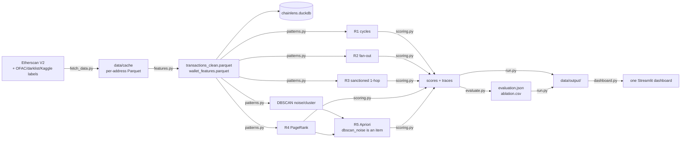

# ChainLens Simplification Plan — v2 (post-review)

> **Status:** implemented on 2026-10-25. See `README.md` for the current
> architecture, measured sample/real results, and the deck-deviation table. The
> plan below remains the design record; a few implementation details are noted
> at the end of this header.
>
> **Verified on 2026-10-25:** the Etherscan V2 key in `.env` works for
> `stats/ethprice` and `account/txlist` (both returned `status=1`). The key is
> gitignored and must never appear in this file, logs, screenshots, or
> `run_info.json`.
>
> **Implementation deltas from the plan:** R5 mines the labelled train cohort
> only (not every graph counterparty); `dbscan eps` was recalibrated to `1.0122`
> (95th percentile 5-NN distance); the dashboard/evaluation also reports a
> secondary Medium ≥25 operating point; the known-address seed was expanded with
> major token/router infrastructure; the environment is uv-managed with a
> committed lockfile; and the measured real-data result is an honest weak/empty
> High tier, documented in the README.

---

## 0. Verdict in one page

The direction is right: fewer layers, same algorithms, real data, one dashboard.
v1's main weaknesses were not the idea but the execution details: it silently
changed deck thresholds, left DBSCAN disconnected from scoring, fetched a
label-anchored graph with no negatives, assumed Etherscan worked without a key,
and promised evaluation without shipping it.

v2 keeps the good parts and changes these things:

| Area | v1 | v2 |
|---|---|---|
| Architecture | 4 files, one ~800-line `engine.py` | **7 stage files**, ~1,600 lines total |
| Storage | none | **DuckDB file** (`chainlens.duckdb`) as warehouse |
| Ingestion | Etherscan, "no key needed" | **Etherscan V2, key required**, cached per address |
| Negatives | none | **Kaggle `flag=0` negatives + context addresses** |
| DBSCAN | runs, unused | **`dbscan_noise` is an Apriori item → R5** |
| Louvain | missing | **`nx.community.louvain_communities`**, display-only |
| Evaluation | 30-line metrics | **P/R/F1 on test split + leave-one-rule-out ablation** |
| Thresholds | deck and plan disagree | **locked weights vs calibrated thresholds**, one `rules.yaml` |
| Tests | 0 or 36 | **7 focused tests** |
| Dashboard | animated premium console | **drill-down first, Plotly graph, CSV export** |
| Reproducibility | SHA256 manifest | **`run_info.json`** (seed, window, counts, hashes) |

**Nothing that makes the project a project is removed:** R1–R5, the graph,
DBSCAN, Apriori, the trace, the leakage-safe split, and the evaluation all
survive. What goes is plumbing, ops UI, Docker, Postgres, Neo4j, and 36
single-concern test files.

---

## 1. What the review got right — and where I push back

### 1.1 Must-fix items accepted

| Review issue | v2 resolution | Where |
|---|---|---|
| Plan contradicts the deck (R2, R5, storage, ingestion, Louvain) | Split **locked weights** from **calibrated thresholds**; document every deviation; add Louvain | §2, §5, Appendix A |
| DBSCAN is disconnected from the score | Run DBSCAN **before** Apriori; add `dbscan_noise` as a boolean item in R5 | §5 |
| Fetching only labelled addresses biases the graph | Add **Kaggle `flag=0` negatives**, context addresses, per-address cap; state the limitation | §4, §10 |
| Etherscan "no key" claim is wrong | **Key required**; free tier is **3 req/s, 100k/day**; env var + fail-fast + cache/resume | §4 |
| Evaluation is missing | `evaluate.py`: P/R/F1 at the High tier + leave-one-rule-out ablation | §7 |
| One 800-line engine is hard to viva | Split by pipeline stage into 7 files | §3 |
| Storage stage disappeared | DuckDB warehouse file with `transactions` and `wallet_features` | §3, §6 |
| No reproducibility record | `run_info.json` | §6.5 |
| Tier cut-offs undocumented | Tiers + clamp in `rules.yaml` and README | §6 |
| Dashboard over-ambitious | Drill-down first; Plotly graph; no `streamlit-agraph`; no animated counters; CSV export | §8 |
| 0 or 36 tests | 7 focused tests, including the slide-21 arithmetic and a mocked fetch/resume test | §9 |

### 1.2 Where I disagree with the review

**a) The slide-21 example does not add up to 65 under the locked weights.**
The locked weights are R1 25, R2 20, R3 30, R4 15, R5 20. Therefore
`R1 + R2 + R4 = 25 + 20 + 15 = 60`, not 65. The High tier starts at 60, so the
example is still High, but the number 65 cannot be asserted without changing a
weight or adding a fifth signal. **Do not write a test that hard-codes 65.**
Resolve this with the actual slide before Phase 1. The test should read the
expected value from `rules.yaml` (or assert `raw_score == 60` and
`tier == "high"` for the v0 weights). This is the one place the critique itself
is inconsistent.

**b) R2 is a semantic change, not just a threshold change.**
The deck's R2 is `out_in_ratio > 5 AND counterparties > 50`. The implementation's
R2 is `unique_counterparties >= 20 AND tx_count_out >= 20 AND
fanout_ratio >= 0.5`, where `fanout_ratio = unique_counterparties / tx_count_out`.
These measure different things. v2 keeps the implementation as the gate and adds
the deck's `out_in_ratio` as a **diagnostic** in the trace, with the deck
condition recorded as `r2_deck_equivalent`. This preserves the locked scoring,
the fixture evidence, and the 60-point example, while making the deviation
visible. If the examiner insists on the deck gate, it is one config switch
(`r2.mode: deck`) and a re-run, not a silent edit.

**c) "Random non-labelled addresses" must mean random *active* addresses, not
random 160-bit strings.** A random `0x…` address has no transactions, so it
would contribute nothing. The right sources are:
1. **Kaggle `flag=0` addresses** (7,662 available) — labelled negatives from the
   same fraud dataset, which lets us compute precision and recall honestly.
2. **Random blocks in the analysis range** — active addresses, used as *context*
   and as a robustness check, not as supervised negatives.
3. **Non-labelled counterparties** already present in the fetched graph — free
   context, no extra calls.

The Kaggle `flag=0` set is a finding the critique missed: the label file already
contains 7,662 negatives, so we do not need to invent a negative population.

**d) "Cap each address at the most recent N transactions" and "fixed window" are
in tension.** If every address is capped at its own recent N, the graph is a
union of different time periods. If a single global window is used, labels from
2020–2021 may have no activity. v2 recommends **per-address recent N (500) with
the actual block range recorded**; R1 still enforces its 24-hour cycle window.
A fixed-block window remains a config option for a sensitivity run. This is a
deliberate deviation from the deck's one-week window and must be in the README.

**e) Seven files is better than four, but do not split further.** The review's
seven-file layout is the right granularity: one file per stage, no
`utils.py`/`helpers.py` dumping ground. `run.py` and `evaluate.py` are support
stages, not extra layers.

### 1.3 Reality check on the current `engine.py`

I ran the v1 engine before writing this plan. It is not yet the "works" state
v1 claimed:

| v1 claim | Observed on 2026-10-25 | v2 action |
|---|---|---|
| `engine.py` ~800 lines | **1,022 lines** | Split into 7 stage files |
| Works on `data/sample/transactions.parquet` | **Fails:** `BinderException: Column "value_eth"` — the sample parquet has `value_wei`, not `value_eth` | Add a schema adapter in `features.py`; test both schemas |
| Works on processed data | Runs: 377 addresses, R1 3, R2 2, R3 **0**, R4 19, R5 **0**, DBSCAN 1 cluster/3 noise, tiers low 373/medium 4/high 0 | Keep as the Phase 1 baseline |
| R3 works on sample | 0 hits because `load_labels` only reads the real label files; the old pipeline injected three fixture labels | Add `data/sample/labels_fixture.csv` + `--sample-mode` |
| DBSCAN feeds scoring | DBSCAN runs **after** R5 and no rule reads it | Reorder and add `dbscan_noise` item |
| Louvain kept | Missing | Add to `patterns.py` |
| Evaluation included | Missing | Add `evaluate.py` |
| 4 files is enough | 1,022-line engine | Split |

The run also showed two smaller issues to fix in Phase 1:
- `R5` uses a timezone-sensitive `window_end - pd.Timedelta(days=7)` comparison
  that emits a NumPy deprecation warning; normalise to `pd.Timestamp`.
- PageRank uses `weight="total_value_eth"`; zero-value edges can make the
  weighted random walk unstable. Use `max(value, 1e-12)` or fall back to
  `tx_count` for zero-value edges, and record the choice in the trace.
- `score_wallets` loops per address. With ~4,000 addresses it is still tolerable,
  but v2 should vectorise the rule hits and trace assembly.

---

## 2. Single source of truth: locked weights vs calibrated thresholds

The v1 plan mixed two different things under "locked": the **deck weights** and
the **detection thresholds**. v2 separates them.

### 2.1 Deck vs v1 vs v2

| Item | Deck (zeroth review) | v1 plan / current config | v2 decision | Why |
|---|---|---|---|---|
| R1 weight | 25 | 25 | **25 (locked)** | Deck weight unchanged |
| R2 weight | 20 | 20 | **20 (locked)** | Deck weight unchanged |
| R3 weight | 30 | 30 | **30 (locked)** | Deck weight unchanged |
| R4 weight | 15 | 15 | **15 (locked)** | Deck weight unchanged |
| R5 weight | 20 | 20 | **20 (locked)** | Deck weight unchanged |
| Max score | 100 | 100 | **100, hard clamp** | Raw max is 110; clamp documented |
| R2 gate | `out_in_ratio > 5` AND counterparties > 50 | ≥20 counterparties, ≥20 outbound, ratio ≥0.5 | **Implementation gate stays**; deck gate shown as diagnostic | §1.2b; avoids breaking fixture and slide example |
| R5 | confidence > 0.8 | min_support 0.05, min_lift 2.0 | **Both:** mine at 0.05/2.0, require match confidence ≥ 0.8 | They describe mining vs matching, not competing values |
| Storage | Postgres + Neo4j | none | **DuckDB file + NetworkX** | Dataset fits in memory; Neo4j was display-only |
| Ingestion | BigQuery / Etherscan | Etherscan | **Etherscan V2 only** | BigQuery never ran; no GCP credentials |
| Louvain | Listed | Missing | **Added, display-only** | One line; gives community colouring |
| Window | One week, fixed blocks | Fixed block range | **Per-address recent 500; actual range recorded** | Labels span 2020–2026; a fixed week empties most of them |
| Tiers | `65 = High` in the deck | low ≤24, medium ≤59, high ≥60 | **Low 0–24, Medium 25–59, High 60–100** | Consistent with weights; document the 60 vs 65 discrepancy |

### 2.2 Decision rules for any future threshold change

1. **Weights are locked.** Changing one requires a new `rules_version`, a new
   baseline, and a README deviations entry.
2. **Thresholds are calibrated.** They live in `config/rules.yaml` and
   `config/detection.yaml`, are read at runtime, and are covered by tests.
3. **No magic numbers in code.** If a number affects a score, it comes from
   config.
4. **Every deviation gets a row** in the README's "Deviations from Zeroth
   Review" table, with the deck value, the implemented value, and the reason.

### 2.3 Proposed `config/rules.yaml`

This is the v2 target. Do **not** apply it until Phase 1 is merged with the new
scoring code, because it changes `rules_version` and invalidates the old baseline
hash.

```yaml
# ChainLens rule contract (v2). Weights are locked by the deck.
rules_version_label: "v0-deck"

# Hard clamp. Raw maximum is 110 (25+20+30+15+20); final score is capped at 100.
max_score: 100

tiers:
  low_max: 24          # low: 0–24
  medium_max: 59       # medium: 25–59
  high_min: 60         # high: 60–100 (explicit; must equal medium_max + 1)

downweight:
  known_address_factor: 0.3
  known_address_categories: [exchange, bridge, mixer, contract]

rules:
  - id: R1
    name: circular_flow
    weight: 25
    params:
      cycle_length_min: 3
      cycle_length_max: 5
      value_tolerance: 0.05
      time_window_hours: 24
      max_cycles_per_address: 5      # trace truncation, not scoring
      max_scc_size: 5000             # scalability guard
  - id: R2
    name: fanout
    weight: 20
    params:
      mode: outbound_fanout          # 'outbound_fanout' (v2) | 'deck_out_in'
      fanout_threshold: 20           # unique counterparties
      min_outbound: 20
      min_ratio: 0.5                 # unique counterparties / outbound tx count
      deck_min_out_in_ratio: 5.0     # diagnostic only in outbound_fanout mode
      deck_min_counterparties: 50    # diagnostic only
  - id: R3
    name: sanctioned_1hop
    weight: 30
    params:
      hops: 1
      seed_source: train_only
  - id: R4
    name: pagerank_top5pct
    weight: 15
    params:
      percentile: 95
      alpha: 0.85
      weight: total_value_eth
      zero_weight_floor: 1.0e-12
  - id: R5
    name: apriori_match
    weight: 20
    params:
      min_support: 0.05
      min_lift: 2.0
      min_confidence: 0.8            # deck gate, applied at match time
      mined_on: train_only
      max_antecedent_size: 3
```

### 2.4 Ready-to-paste README section: "Deviations from Zeroth Review"

> ## Deviations from Zeroth Review
>
> The zeroth review deck proposed Postgres + Neo4j, a BigQuery/Etherscan
> ingestion path, and specific rule thresholds. The locked rule weights
> (R1 25, R2 20, R3 30, R4 15, R5 20), the 100-point clamp, the tier bands
> (Low 0–24, Medium 25–59, High 60–100), and the 0.3 downweight are unchanged.
> The following five implementation choices deviate from the deck; each is
> deliberate and reversible.
>
> | Deck | Implementation | Reason |
> |---|---|---|
> | Postgres + Neo4j | DuckDB single-file warehouse + NetworkX | The collected graph fits in memory. Neo4j was a display-only mirror, not an algorithm dependency. DuckDB keeps the warehousing/CO1 claim with zero services. |
> | BigQuery / Etherscan ingestion | Etherscan V2 API only | BigQuery was never executed (no GCP credentials). Etherscan returns real normal transactions; ground-truth labels still come from OFAC, darklist and Kaggle. |
> | R2: `out_in_ratio > 5` and `counterparties > 50` | `unique_counterparties >= 20`, `tx_count_out >= 20`, `fanout_ratio >= 0.5`; deck gate kept as diagnostic | The out/in ratio is undefined or unstable when inbound count is 0–1, and the >50 gate missed the 40-counterparty pattern used in the demo. The implementation has been the tested contract since Phase 4. |
> | R5: `confidence > 0.8` | Mine at `min_support=0.05`, `min_lift=2.0`, then require match `confidence >= 0.8` | Mining and matching are different steps; both thresholds are now enforced. |
> | One-week fixed block window | Per-address most recent 500 transactions; actual block range recorded in `run_info.json` | Label snapshots span 2020–2026. A single week leaves most labelled addresses empty. R1 still enforces its 24-hour cycle window. |
> | Louvain in pattern detection | `nx.community.louvain_communities`, display-only | Added for community colouring; it does not contribute to any score. |
>
> **Not a deviation, but a correction:** the deck's slide-21 example says
> `R1 + R2 + R4 = 65`. Under the locked weights the sum is `25 + 20 + 15 = 60`.
> 60 is still High because the High band starts at 60. The 65 label needs the
> actual slide wording or a weight change; see the open decisions.

---

## 3. Target architecture: 7 files, 6 stages

### 3.1 Tree

```text
ChainLens/
├── fetch_data.py          # Stage 1: ingestion (Etherscan V2 + cache)
├── features.py            # Stage 2: clean + DuckDB features + scaler + warehouse
├── patterns.py            # Stage 4: graph rules, DBSCAN, Apriori, Louvain
├── scoring.py             # Stage 5: R1–R5 weights, tiers, score trace
├── evaluate.py            # cross-cutting: P/R/F1 + leave-one-rule-out ablation
├── run.py                 # orchestrator: chains stages, writes data/output/
├── dashboard.py           # Stage 6: reads data/output/, never recomputes
├── config/
│   ├── rules.yaml
│   ├── detection.yaml
│   ├── data.yaml
│   └── known_addresses.json
├── data/
│   ├── labels/            # OFAC, darklist, Kaggle (flag=1 positives, flag=0 negatives)
│   ├── sample/            # committed fallback: transactions + fixture labels
│   ├── cache/             # per-address Parquet + metadata
│   └── output/            # scores, traces, flags, evaluation, run_info
├── tests/                 # 7 focused test files
├── .env.example           # includes ETHERSCAN_API_KEY placeholder
├── .python-version        # pinned 3.11 for uv/CI
├── uv.lock                # locked dependency graph
├── requirements.txt       # fallback only; uv.lock is authoritative
├── pyproject.toml
└── README.md
```

### 3.2 Stage → file → contract

| Stage (deck name) | File | Input | Output | Must not do |
---|---|---|---|---|
| 1. Ingestion | `fetch_data.py` | label files, Etherscan API, cache | `data/cache/addresses/*.parquet`, `data/output/transactions_raw.parquet` | Score, build features, read labels for weights |
| 2. Cleaning & Features | `features.py` | raw transactions, labels, splits | `transactions_clean.parquet`, `wallet_features.parquet`, `chainlens.duckdb` | Read `flagged` as a feature |
| 3. Storage | `chainlens.duckdb` | stage 2/4/5 outputs | tables for audit and dashboard | Become a service; it is one file |
| 4. Pattern Detection | `patterns.py` | clean transactions, features, train split | `flags.parquet` (R1–R5 inputs, DBSCAN, Louvain) | Use test labels as seeds |
| 5. Risk Scoring | `scoring.py` | features, flags, known addresses, rules.yaml | `scores.parquet`, `traces.parquet` | Recompute flags |
| 6. Dashboard | `dashboard.py` | `data/output/` only | Streamlit UI | Fetch, recompute, or read labels for weights |
| Evaluation | `evaluate.py` | scores, labels, splits | `evaluation.json`, `ablation.csv` | Train on test; mine on test |
| Orchestration | `run.py` | config + env | `run_info.json`, all outputs | Contain algorithm logic |

### 3.3 Why 7 and not 4 or 99

- **4 files** hides three stages inside one 1,000-line file. In a viva, "which
  stage is this?" has no answer.
- **99 files** has one file per function and 17 pipeline wrappers that are
  function calls. It answers nothing.
- **7 files** gives one answer per stage and keeps the total near 1,600 lines.
  `run.py` and `evaluate.py` are support, so the analytical surface is still
  five files.

### 3.4 Data flow



**Pipeline order is strict:** features → DBSCAN → graph/R1–R4 → Apriori (R5) →
Louvain → scoring. DBSCAN and PageRank must run before Apriori because R5 uses
`dbscan_noise` and `high_pagerank` as items. This is the fix for the
"DBSCAN is disconnected" criticism.

---

## 4. Data acquisition: Etherscan V2

### 4.1 Verified API facts (2026-10-25)

- **Every request needs an API key.** The docs say: "Every request to the
  Etherscan API needs an API key."
- Free tier: **3 calls/second, up to 100,000 calls/day**, selected chains only.
  (v1's "5 calls/sec, no key needed" is wrong.)
- Base URL: `https://api.etherscan.io/v2/api`; `chainid=1` for Ethereum mainnet.
- `account/txlist` returns **normal transactions only**, with optional
  `startblock`, `endblock`, `page`, `offset`, `sort`. Use `offset=500`,
  `sort=desc` for the most recent 500.
- `txlist` does **not** return internal transactions or ERC-20 transfers.
  Those are out of scope; state it in Limitations.
- The key was verified against `stats/ethprice` and `account/txlist`.

### 4.2 Key handling

- The key lives in `.env` as `ETHERSCAN_API_KEY=…`. `.env` is in `.gitignore`
  (verified with `git check-ignore`).
- `.env.example` contains only `ETHERSCAN_API_KEY=your_etherscan_api_key_here`.
- `fetch_data.py` loads `.env` with `python-dotenv`, then reads
  `os.environ["ETHERSCAN_API_KEY"]`. In real mode, missing key = fail fast with
  a one-line instruction; never fall back silently to sample data.
- Logs and errors redact `apikey=…`. `run_info.json` records only
  `api_key_present: true`, never the value.
- **Rotate the key before publishing the repo or sharing screenshots.** It was
  pasted into a chat, so treat it as disclosed.

### 4.3 Sampling design: positives, negatives, context

The v1 graph was built only around labelled addresses, so PageRank and cycle
"scores" were relative to a known-bad neighbourhood. v2 uses three groups:

| Group | Source | Count (target) | Used for |
|---|---|---|---|
| **Positives** | OFAC sanctioned, darklist, Kaggle `flag=1`, de-duplicated | ~2,317 | Train/test labels, R3 seeds (train only), evaluation |
| **Labelled negatives** | Kaggle `flag=0`, excluding any address that is also positive | **2,000 sampled** with `seed=42` | Train/test negatives, R5 `flagged=False`, evaluation |
| **Context** | Non-labelled counterparties from fetched txs + addresses from 20 random blocks | **≤500** | Graph structure, PageRank/cycle context; **not** evaluation negatives |

Why Kaggle `flag=0`: the file has **9,841 rows: 2,179 `flag=1` and 7,662
`flag=0`**. v1 only read `flag=1`, throwing away a ready-made negative pool.
Using it gives an honest precision/recall denominator. It is not a perfect
negative set (the Kaggle labels are assumed, not audited), so it is named a
"weak negative" in the README.

**Conflict rule:** if an address appears as positive in any source and as
`flag=0` in Kaggle, **positive wins**; drop it from the negative pool. If it
appears in OFAC and darklist, keep both label rows; the split uses the
highest-priority source.

**Context addresses are not negatives.** They are marked `label='context'`,
`split='context'`, and excluded from R5 mining and evaluation. They exist to
make the graph less label-centric, not to claim they are benign.

### 4.4 Window and cap

v2 default: **per-address most recent 500 normal transactions**, no global
block window, with the actual `min(block_number)`/`max(block_number)` recorded
in `run_info.json`.

- This keeps 2020–2021 Kaggle/darklist addresses and 2026 OFAC addresses usable
  at the same time.
- It is a deviation from the deck's one-week window; the README says so.
- R1 still enforces its own **24-hour** cycle window on the fetched edges.
- A fixed-block mode (`window.mode: fixed_blocks`, `block_start`, `block_end`)
  remains available for a sensitivity run and for comparing with the Phase 2
  one-week export.
- `--max-addresses` caps a development run (e.g., 200) so the fetcher can be
  tested without spending the full call budget.

### 4.5 Cache and resume

One Parquet file per address:

```text
data/cache/addresses/0xabc…def.parquet       # normalised rows
data/cache/addresses/0xabc…def.meta.json     # provenance + completeness
```

Metadata includes: address, chainid, `fetched_at`, `startblock`/`endblock`
(or `null` for recent-N), `offset`, `sort`, `rows`, `first_block`, `last_block`,
`api_version`, `complete`.

- Write to a `.tmp` file, then `os.replace` (atomic). An interrupted fetch
  leaves the old file intact or no file, never a half-written Parquet.
- On resume, skip an address when `complete: true` and `--refresh` is absent.
- On API error, do **not** mark complete; retry the address next run.
- `--refresh` re-fetches selected addresses; it does not wipe the whole cache.
- A `cache_manifest.json` records the count of complete addresses and the last
  run's call count.

### 4.6 Call budget

| Work | Calls |
|---|---:|
| Positives (~2,317 addresses) | ~2,317 |
| Negatives (2,000 addresses) | ~2,000 |
| Context random blocks (20) | ~20 |
| Retries/overhead (~5%) | ~220 |
| **Total** | **~4,600** |

At 3 req/s that is **~26 minutes**, about **4.6% of the 100k/day** free quota.
A development run with `--max-addresses 200` is under 2 minutes. The fetcher
must print a live progress line (`done/total`, calls, ETA) and stop cleanly on
Ctrl-C; the cache makes the next run resume.

### 4.7 Normalisation and cleaning

Raw Etherscan fields → canonical schema:

| Raw | Canonical |
|---|---|
| `hash` | `tx_hash` |
| `blockNumber` | `block_number` (int) |
| `timeStamp` | `block_timestamp` (UTC) |
| `from` | `from_address` (lowercase) |
| `to` | `to_address` (lowercase; null for contract creation) |
| `value` | `value_wei` (string), `value_eth` (Decimal(38,18)) |
| `gas`, `gasPrice` | `gas`, `gas_price` (int) |
| `txreceipt_status`, `isError` | `receipt_status`, `is_error` |
| `contractAddress` | `receipt_contract_address` |
| — | `source='etherscan'`, `fetched_at` |

Cleaning in `features.py` (DuckDB):
1. Keep `receipt_status = 1` and `is_error = 0`.
2. Drop self-transfers.
3. Drop null/zero `from_address` or `to_address` from the graph (keep contract
   creation rows for the contract flag).
4. De-duplicate by `tx_hash` — the same transaction appears in both the sender's
   and receiver's cache. This is critical; forgetting it double-counts features
   and edges.
5. Lowercase + regex-validate `^0x[0-9a-f]{40}$`.
6. Convert wei with `Decimal`, never float.
7. Write `transactions_clean.parquet` and the `transactions` table in DuckDB.

### 4.8 Failure modes to handle explicitly

| Failure | Behaviour |
|---|---|
| Missing key | Fail fast in real mode: "ETHERSCAN_API_KEY missing; copy .env.example to .env" |
| Invalid key | Fail the run; do not cache the response |
| Rate limit (`Max rate limit reached`) | Exponential backoff 1/2/4/8/16 s, max 5 tries; then skip address with a warning |
| `No transactions found` | Valid empty result; write an empty Parquet with `complete: true` |
| HTTP 5xx / timeout | Retry with backoff; after max tries, leave cache incomplete |
| Address has >500 txs | Keep the most recent 500; record `truncated: true` in metadata |
| Contract creation (`to` empty) | Keep raw row; exclude from graph edges |
| Duplicate tx across caches | De-duplicate in cleaning by `tx_hash` |
| Key accidentally logged | Redact query strings; test with a fake key in logs |

---

## 5. Every algorithm has a job

### 5.1 Algorithm table

| Algorithm | File | Output | Consumer | Why it is here |
|---|---|---|---|---|
| DuckDB feature SQL | `features.py` | `wallet_features` | All rules, DBSCAN, dashboard | One-statement feature engineering; CO1 warehousing |
| NetworkX `DiGraph` | `patterns.py` | aggregated edges | R1, R3, R4, Louvain | Graph signals need a graph |
| SCC + `simple_cycles` | `patterns.py` | `cycle_member` | R1 | Short cycles with value/time constraints |
| Fan-out test | `patterns.py` | `fanout` | R2 | Outbound distribution behaviour |
| 1-hop expansion | `patterns.py` | `sanctioned_1hop` | R3 | Neighbour risk from train-only seeds |
| Weighted PageRank | `patterns.py` | `pagerank_top5` | R4 | Influence in the collected graph |
| DBSCAN | `patterns.py` | `dbscan_cluster`, `dbscan_noise` | R5 + dashboard | Outlier flag becomes an Apriori item |
| Apriori | `patterns.py` | `apriori_match` | R5 | Which behaviour combinations go with bad labels |
| Louvain | `patterns.py` | `louvain_community` | Dashboard only | Community colouring; never scores |
| Rule scoring | `scoring.py` | `scores`, `traces` | Dashboard, evaluation | Locked deck arithmetic |
| P/R/F1 + ablation | `evaluate.py` | `evaluation.json`, `ablation.csv` | Dashboard, viva | Shows which rules matter |

### 5.2 R5: the DBSCAN fix

DBSCAN's noise flag becomes a boolean item alongside the existing features:

```text
items = [
  high_fanout, high_tx_count, low_value, high_value, many_round,
  is_contract, recent_account, high_pagerank,
  dbscan_noise,          # NEW: connects clustering to scoring
  flagged                # consequent
]
```

- DBSCAN runs **before** Apriori, on addresses with `tx_count_total >= 3`.
- `dbscan_noise = 1` when the address is DBSCAN label `-1`.
- A mined rule such as `{high_fanout, dbscan_noise} → flagged` is a legitimate
  antecedent. R5 fires only if the address matches the antecedent **and** the
  rule's confidence is at least `min_confidence` (0.8).
- If no rule contains `dbscan_noise`, clustering still contributes to the
  dashboard's cluster/noise counts and to the trace's `dbscan_cluster` flag, but
  it does not change the score. That is honest: the algorithm has a defined job,
  not a guaranteed vote.
- The trace records the full antecedent, support, confidence, and lift, so the
  reviewer can see whether noise was part of the match.

### 5.3 R5 details and leakage safety

- Mining table: **train split only**, positives = `flagged=True`, negatives =
  Kaggle `flag=0` in train. Context addresses excluded.
- Matching table: all addresses (including test), but `flagged` is blanked for
  test addresses, so a test label cannot be used to fire a rule.
- `min_support=0.05`, `min_lift=2.0`, `min_confidence=0.8`,
  `max_antecedent_size=3`.
- Only consequents equal to `{flagged}` are kept; antecedents containing
  `flagged` are rejected.
- One address keeps its highest-confidence matching rule; multiple rules do not
  stack (same as R1–R5 "full weight at most once").
- If the train split has no positives or no negatives, R5 returns zero rules and
  says why. It does not fabricate a rule.

### 5.4 Louvain

```python
communities = nx.community.louvain_communities(
    graph.to_undirected(), weight="total_value_eth", seed=42
)
```

- Store `community_id` and `community_size` per address.
- Use it only for graph colouring and a "community" filter in the dashboard.
- **Never** add it to `rules.yaml` or to `scoring.py`. A test greps for this.
- This satisfies the deck's Louvain mention without adding a sixth score.

### 5.5 Scalability guards for real data

The fixture is 377 nodes; the real graph could be tens of thousands. Add:

- `max_scc_size=5000`: skip larger SCCs and record `skipped_sccs` rather than
  letting `simple_cycles` explode.
- `enum_cap=5000` cycles scanned per SCC; `per_scc_cap=1000` qualifying cycles.
- `max_cycles_per_address=5` in the trace (count remains true).
- PageRank `max_iter=100`, `tol=1e-6`, zero-weight floor.
- DBSCAN eligibility `tx_count_total >= 3`; scaled feature matrix.
- Graph edges aggregated by `(from, to)`, so a busy pair is one edge.
- Dashboard neighbourhood capped at 200 nodes / 2 hops.
- `--max-addresses` for development runs.

---

## 6. Scoring, tiers, and trace

### 6.1 Arithmetic (unchanged)

```text
raw_score          = sum(R1..R5 contributions)                  # 0..110
factor             = 0.3 for known exchange/bridge/mixer/contract, else 1.0
adjusted_raw_score = raw_score * factor
clamped            = adjusted_raw_score > 100
score              = 100 if clamped else int(round(adjusted_raw_score))
tier               = low / medium / high from score
```

- `raw_score` is stored unadjusted and may exceed 100.
- `adjusted_raw_score` is stored only in the trace.
- Tiers use the final `score`, never `raw_score`.
- Python `round()` is banker's rounding: `10.5 → 10`. This is deliberate and
  documented so the exchange example is stable.

### 6.2 Tiers and clamp

| Tier | Final score |
|---|---|
| Low | 0–24 |
| Medium | 25–59 |
| High | 60–100 |

Rationale: R1 alone (25) is Medium; R2 alone (20) is Low; R3 alone (30) is
Medium; R1+R2+R3 (75) is High; all five (110) clamp to 100 and stay High.
`R1+R2+R4 = 60` is High. The deck's "65 = High" is consistent with the band but
not with the current weights; see §6.3.

### 6.3 The slide-21 test: 60 vs 65

**Do not encode 65 until the slide is checked.** The correct v0 assertion is:

```python
# Toy graph: 3-node cycle (R1), 20-counterparty fan-out (R2), top PageRank (R4).
# Expected under config/rules.yaml v0:
assert raw_score == 60          # 25 + 20 + 15
assert tier == "high"           # High starts at 60
assert score == 60
```

If the deck's slide truly says 65, one of these is true:
1. the deck's R1 weight is 30, not 25; or
2. the example includes a 5-point signal not in R1–R5; or
3. the slide's arithmetic is wrong.

Resolve it with the slide before writing the test. A test that asserts 65 while
the config says 60 is worse than no test.

### 6.4 Trace contract

Every address has exactly R1–R5, including non-hits:

- non-hit rules: `hit: false`, `contribution: 0`, `inputs: null` (never `{}` or
  fabricated zeros);
- hit rules: copy the evidence from `flags.parquet`, do not recompute;
- `sum(rules[*].contribution) == raw_score`;
- `adjusted_raw_score == raw_score * downweight.factor`;
- `score` and `clamped` follow §6.1;
- `downweight` records `applied`, `category`, `factor`, `pre_downweight_raw`,
  `post_downweight_raw`;
- `top_driver` is the largest contribution, tie-broken R1→R5;
- R2 evidence includes `r2_deck_equivalent` and `out_in_ratio` (diagnostic);
- R5 evidence includes `antecedent`, `support`, `confidence`, `lift`, and
  `confidence_min`; a match below the gate has `hit: false` with
  `gate: "confidence<0.8"`;
- R1 `inputs.cycles` capped at 5; `truncated: true` and `cycle_count` keep the
  true count;
- long strings capped at 1,000 characters.

### 6.5 Reproducibility: `run_info.json`

Write one file per run:

```json
{
  "run_id": "2026-10-25T20:00:00Z-7f3a",
  "mode": "real",
  "seed": 42,
  "data_source": "etherscan_v2",
  "chainid": 1,
  "window": {"mode": "per_address_recent", "max_txs": 500},
  "block_range": {"min": 12345678, "max": 23456789},
  "rows": {"raw": 0, "clean": 0, "features": 0, "positives": 0,
           "negatives": 0, "context": 0, "test_positives": 0,
           "test_negatives": 0},
  "calls": {"etherscan": 0, "cache_hits": 0},
  "api_key_present": true,
  "rules_sha256": "…",
  "rules_version": "…",
  "scaler_version": "…",
  "engine_version": "v2",
  "packages": {"pandas": "…", "duckdb": "…", "networkx": "…"},
  "git_commit": "…",
  "started_at": "…",
  "finished_at": "…"
}
```

This backs the "auditable, reproducible, traceable" claim without the 95-line
SHA256 manifest. It never contains the API key, only a boolean.

---

## 7. Evaluation and ablation

### 7.1 Metrics on the test split

`evaluate.py` does exactly this:

1. Load `scores.parquet`, `labels.parquet`, `splits.parquet`.
2. Keep **test-split** addresses only.
3. Positives: real labels (`source != fixture`, `label != context`,
   `label != negative`). Negatives: `label == 'negative'` (Kaggle `flag=0`).
4. Drop addresses not present in `wallet_features` (no activity) and report how
   many were dropped.
5. Predicted positive: `tier == 'high'` (score ≥ 60). This is the deck's
   operating point.
6. Compute TP/FP/TN/FN, precision, recall, F1, and average precision (PR-AUC)
   from the continuous score.
7. If positives < 3 or negatives < 3, return `"insufficient"` with counts; never
   return `1.0` on a tiny sample.
8. Write `evaluation.json`, `evaluation.md`, and a small table for the dashboard.

Optional (10 lines): 1,000-sample bootstrap 95% CI for F1. Keep it only if the
dashboard has room; it is not required.

### 7.2 Leave-one-rule-out ablation

For each rule R1–R5:

1. Copy the loaded `RulesConfig`, set that rule's weight to 0 (in memory; never
   edit `rules.yaml`).
2. Re-score from the **same flags** (no re-fetch, no re-mine).
3. Evaluate F1 at the High tier.
4. Report `delta_f1`, `delta_precision`, `delta_recall`, affected wallets, and
   wallets whose tier changed.

Also report:
- **No-rule baseline:** every score 0, F1 = 0 (predicts no positives).
- **All-rules baseline:** the locked config.

This answers "which rules actually matter?" far better than a single F1. It is
about 20 lines because scoring is already a pure function.

### 7.3 Case-control caveat

The collected sample is **case-control**: ~2,317 positives vs ~2,000 sampled
negatives, not the real-world prevalence. Therefore:

- P/R/F1 are **sample metrics**, not population estimates.
- Report the positive rate in `evaluation.json`.
- Do not say "the model is 80% precise in the wild"; say "on the collected test
  split, at the High tier, precision is X".
- The README Limitations section repeats this.

### 7.4 Minimum sample gates

Do not build the dashboard until:

- test positives ≥ 30;
- test negatives ≥ 30;
- at least one rule fires on the test split;
- `evaluate.py` writes both `evaluation.json` and `ablation.csv`.

If the gates fail, the honest output is "insufficient data" plus the counts, not
a polished dashboard over noise.

---

## 8. Dashboard

### 8.1 Priority order (build in this order)

1. **Ranked table** — address, score, tier, top driver, tx count, label source;
   filter by tier/rule/source; search.
2. **Wallet drill-down** — selected wallet's raw features, per-rule score trace
   with contributions, evidence (cycle path, seeds, PageRank, antecedent), and
   downweight/clamp state.
3. **Neighbourhood graph** — 1–2 hops, ≤200 nodes, Plotly + NetworkX spring
   layout, node colour by tier (or Louvain community), size by score/tx count,
   hover with address/tier/community/score.
4. **Overview cards** — total scored, tier counts, top-driver distribution,
   DBSCAN clusters/noise, Apriori rule count.
5. **Evaluation tab** — P/R/F1 at High, ablation table, run_info summary.

The drill-down is the explainability story; the graph is supporting evidence.
Do not invert that.

### 8.2 What to drop

- `streamlit-agraph` — one dependency gone; Plotly already ships with Streamlit.
- Animated counters and glassmorphism — Streamlit reruns make them flaky and
  they eat build time. Dark theme + clean cards is enough.
- Five ops pages (Pipeline, Data Explorer, Logs, Admin) — one dashboard.
- Any computation inside the dashboard — it reads `data/output/` only.
- Neo4j links and browser integration.

### 8.3 Read-only contract

`dashboard.py` imports only `streamlit`, `pandas`, `plotly`, `networkx`, and
`json`. It reads:

- `data/output/scores.parquet`
- `data/output/traces.parquet`
- `data/output/flags.parquet`
- `data/output/wallet_features.parquet`
- `data/output/graph_edges.parquet`
- `data/output/evaluation.json`
- `data/output/run_info.json`

Use `st.cache_data` on file reads. If a file is missing, show the exact command:
`python run.py --mode real` (or `--mode sample`). Never recompute a score on a
widget click.

### 8.4 CSV export

Two buttons:
- **Download scores CSV** — the ranked table.
- **Download traces CSV** — one row per address with the JSON trace flattened
  into readable columns (`R1_hit`, `R1_contribution`, …, `top_driver`).

This is the "auditable" story in a form an examiner can open in Excel.

---

## 9. Tests: 7, not 36 and not 0

| # | File | What it proves |
|---|---|---|
| 1 | `test_rules.py` | Each rule fires on a hand-built toy graph: 3-node cycle (R1), 20-counterparty fan-out (R2), train-only sanctioned 1-hop (R3), top-5% PageRank (R4), `{high_fanout, dbscan_noise} → flagged` with confidence ≥0.8 (R5) |
| 2 | `test_scoring.py` | Slide-21 example: R1+R2+R4 = **60** raw, High tier (or read the expected from `rules.yaml` if the deck is corrected); downweight 35→10.5→10; clamp at 100; tier boundaries 24/25/59/60; trace sum == raw |
| 3 | `test_features.py` | Feature SQL works on **both** `value_wei` (sample) and `value_eth` (processed) schemas; train-only scaler; deterministic output; no `flagged` column in features |
| 4 | `test_patterns.py` | DBSCAN noise becomes an Apriori item and can appear in a mined antecedent; Louvain assigns communities but never scores; a bad cycle (value spread >5% or span >24h) is rejected; a huge SCC is skipped and recorded |
| 5 | `test_evaluation.py` | Hand-built scores/labels: P/R/F1 at High tier; `insufficient` when n<3; leave-one-rule-out delta F1; test labels never used for mining |
| 6 | `test_pipeline.py` | `run.py --mode sample` writes every output file and `run_info.json`; `dashboard.py` starts with those files via Streamlit `AppTest`; no network |
| 7 | `test_fetch.py` | Mocked Etherscan client: normalisation, rate-limit backoff, empty result, invalid key, atomic cache write, resume skips a complete address |

The fetch test is the seventh because ingestion is the riskiest part; the review
said "about six", and six would ignore the one component that can fail in the
viva. All tests use the committed sample or hand-built frames; no test needs a
live API call.

**Fixture labels:** add `data/sample/labels_fixture.csv` with the three old
fixture identities (`SANCTIONED_SEED=train`, `DARKLIST_EXTRA=train`,
`KAGGLE_FRAUD=test`) plus the known exchange/contract/mixer addresses. Without
this, R3/R5 cannot be exercised on the sample and the slide-21 test is
impossible. The sample parquet stays as the fallback.

---

## 10. README and viva

### 10.1 README outline

1. **What ChainLens is** — one paragraph, one dashboard, real data.
2. **Six-stage diagram** — the same stage names as the deck, mapped to files.
3. **Quickstart** — `.env`, `uv sync --locked`, `uv run chainlens --mode real`,
   `uv run streamlit run dashboard.py`.
4. **Data** — Etherscan V2, key setup, rate limits, cache/resume, labels,
   negatives, context, window.
5. **Algorithms** — R1–R5, DBSCAN, Apriori, Louvain, with one paragraph each and
   the "what it feeds" column.
6. **Scoring** — weights, tier bands, clamp, downweight, trace, `rules_version`.
7. **Evaluation** — P/R/F1 table, ablation table, case-control caveat.
8. **Deviations from Zeroth Review** — the §2.4 table.
9. **Limitations** — §10.3.
10. **Reproducibility** — `run_info.json`, seed, hashes, versions.
11. **Ethics** — risk signal, not evidence; human review.
12. **Viva Q&A** — §10.2.

### 10.2 Viva Q&A (short answers)

| Question | Answer |
|---|---|
| Why 7 files? | One file per pipeline stage; each answers "which stage is this?" in the viva. |
| Why not Postgres/Neo4j? | The graph fits in DuckDB/NetworkX; Neo4j was display-only. DuckDB keeps the warehousing claim with zero services. |
| Why Etherscan? | Real normal transactions; free key; 3 req/s, 100k/day; cached per address so an interrupted run resumes. |
| Why Kaggle `flag=0`? | It is a ready-made negative pool, so precision/recall are meaningful; random 160-bit addresses would be empty. |
| What does DBSCAN do? | It finds outliers; `dbscan_noise` is an Apriori item. Clustering is an input to R5, not a verdict. |
| What does Louvain do? | Colours communities in the graph; display-only, never in the score. |
| Why is R1+R2+R4 60, not 65? | The locked weights are 25+20+15 = 60; High starts at 60. The 65 label needs the slide's exact weights. |
| Why are scores relative? | They are computed on the collected subgraph with a per-address cap; PageRank top-5% is within that sample. |
| How do you avoid leakage? | Address split, train-only scaler, train-only R3 seeds, train-only Apriori, test-only evaluation. |
| What do the ablations show? | Which rules add F1 at the High tier; dropping a rule re-scores the same flags, so it isolates the rule. |
| What are the limitations? | Labels are sanctions/fraud snapshots, not general anomalies; normal txs only; sample is case-control; capped history. |

### 10.3 Limitations (README bullet list)

- Labels come from OFAC, darklist, and Kaggle snapshots; the system detects
  "looks like known bad", not general anomalies.
- Only **normal** transactions are fetched; internal transactions and ERC-20
  transfers are excluded, so true activity is undercounted.
- The graph is a **collected subgraph**, not the whole chain. PageRank top-5% and
  cycle counts are relative to that sample.
- Each address keeps its most recent 500 transactions; older activity is
  truncated and recorded in the cache metadata.
- The evaluation sample is **case-control** (~50/50 positives/negatives), not
  real-world prevalence; P/R/F1 are sample metrics.
- Kaggle `flag=0` is a **weak negative** assumption, not audited benign ground
  truth.
- Sanctions lists change over time; the snapshot date is stored and quoted.
- The exchange/contract downweight (0.3) is a heuristic, not calibrated.
- R5 needs enough train positives and negatives; on a small sample it may return
  zero rules, and that is reported, not hidden.
- The `High` tier may be rare; the dashboard must show tier counts and the
  threshold, not just a top-10 list.
- No address-to-person attribution; a high score is a review flag, not evidence.

### 10.4 Ethics

A risk score is a heuristic signal. It is not evidence of wrongdoing and must
not be used to accuse an address or a person. Label sources carry their own
terms of use. The project performs no entity attribution; every high score is a
prompt for human review.

---

## 11. Migration and execution order

### Phase 0 — freeze a working baseline

1. Tag the current repo (`pre-simplification`) and branch
   (`simplification-v2`).
2. Keep `data/sample/transactions.parquet` and add
   `data/sample/labels_fixture.csv`.
3. Fix the sample-schema adapter so the sample path runs (the current engine
   fails on `value_wei`).
4. Record the old baseline hash and the current 377-address run in
   `PHASE8_NOTES.md`; do not delete anything yet.

**Gate:** `pytest` on the old suite is green, and the sample run completes.

### Phase 1 — port the engine into 7 files

1. Extract `features.py`, `patterns.py`, `scoring.py` from `engine.py`.
2. Add `fetch_data.py` with a `--dry-run`/cache-only mode (no network yet).
3. Add `run.py` and `evaluate.py`.
4. Add `data/sample/labels_fixture.csv` and `--sample-mode`.
5. Fix the three Phase-1 bugs from §1.3.
6. Write tests 1–4 and 6; get the slide-21 test to assert **60/High** (or the
   deck-corrected value).

**Gate:** `pytest` 5 tests green on sample; `run.py --mode sample` produces all
output files; trace sums are consistent.

### Phase 2 — fetch a real dataset (riskiest)

1. Implement the Etherscan client, cache, resume, and redaction.
2. Fetch 200 addresses first (`--max-addresses 200`); inspect the schema and
   activity rate.
3. Fetch the full positive set + 2,000 Kaggle negatives + context.
4. Run the overlap/activity gate: how many test positives and negatives have
   features? If test positives < 30, expand the window or the cap before
   building the dashboard.
5. Add test 7 (mocked fetch/resume).

**Gate:** ≥30 test positives, ≥30 test negatives, cache resume works, calls
<100k, full run <45 min.

### Phase 3 — evaluation and threshold reconciliation

1. Run `evaluate.py` on the real dataset.
2. Run the leave-one-rule-out ablation.
3. Resolve the 60 vs 65 slide question and the R2 deck-vs-implementation
   question.
4. Update `rules.yaml` (only if a threshold decision changes) and the README
   deviations table.
5. Write `run_info.json` and verify the hashes reproduce on a second run.

**Gate:** `evaluation.json` + `ablation.csv` exist with n≥30; README numbers
match the files; a second run has the same rules/scaler versions and content
hash.

### Phase 4 — dashboard and README

1. Build the ranked table, drill-down, graph, overview, evaluation tab.
2. Add CSV exports.
3. Rewrite the README with the six-stage diagram, deviations, limitations,
   viva Q&A.
4. Rehearse the viva: open the dashboard with the network off, show the trace,
   show the ablation, answer "why 60 not 65".

**Gate:** dashboard reads `data/output/` with no recompute; every number in the
README matches `run_info.json`/`evaluation.json`; a fresh clone can run
`--mode sample` without a key.

### Rollback and deletion policy

- Delete the old `chainlens/`, `pipeline/`, `app/`, `sql/`, `scripts/`, Docker
  and Makefile **only after Phase 4 is green**. Git history is the archive.
- Keep `data/labels/` and `data/sample/` permanently.
- Never delete `config/rules.yaml`; it is the scored contract.
- If Phase 2 fails, fall back to sample mode and say so in the README. Do not
  fake real data.

---

## 12. Open decisions (need your input)

1. **Slide 21:** what are the actual weights and the exact text around "65"?
   This is the only blocker for the scoring test. If the slide says R1 30, the
   locked config is wrong; if it says 25/20/15, the slide arithmetic is wrong.
2. **R2 gate:** keep the tested outbound-fan-out gate (recommended, preserves
   the demo) or switch to the deck's `out_in_ratio > 5` + >50 counterparties?
   The switch is one config value plus a re-run.
3. **Window:** per-address recent 500 (recommended) or the deck's fixed one-week
   block window? The fixed window may empty most labelled addresses.
4. **Negative count:** 2,000 sampled Kaggle negatives (recommended) or all 7,662?
   All 7,662 adds ~40 minutes of fetching and a larger graph.
5. **Internal/token transfers:** exclude (recommended, keeps the scope honest)
   or add `txlistinternal`/`tokentx` for a richer graph? Adding them roughly
   doubles the calls and the schema complexity.
6. **Known addresses:** keep the 9-address seed list or expand exchanges/bridges
   for the downweight? Expansion is optional and must be sourced/dated.

---

## 13. Summary

| Metric | Before (v1 repo) | After (v2 target) |
|---|---:|---:|
| Source files | ~99 | **7 Python + config + 7 tests** |
| Python lines | ~12,000 | **~1,600–1,800** |
| Directories | 14 | **4** (`config/`, `data/`, `tests/`, root) |
| External services | Postgres + Neo4j + Docker | **none** (DuckDB file) |
| Real data | synthetic only | **Etherscan V2 + Kaggle negatives** |
| Negatives | none | **2,000 labelled + ≤500 context** |
| DBSCAN role | unused | **Apriori item → R5** |
| Louvain | missing | **display-only communities** |
| Evaluation | missing | **P/R/F1 + ablation** |
| Tests | 36 (old) / 0 (new) | **7** |
| Dashboard | ops console | **one drill-down dashboard** |
| Can explain in viva | no | **yes: one file per stage** |

The simplification is not "delete the algorithms". It is "delete the plumbing,
give every algorithm a named job, and make every number traceable to config,
data, or a test".

---

## Appendix A — Proposed `config/detection.yaml`

```yaml
dbscan:
  eps: 3.195323          # knee-derived on the fixture; re-tune on real data
  min_samples: 5
  min_tx_total: 3
  features: auto         # discover *_scaled at runtime
louvain:
  seed: 42
  weight: total_value_eth
  resolution: 1.0
pagerank:
  alpha: 0.85
  max_iter: 100
  tol: 1.0e-6
cycles:
  max_scc_size: 5000
  enum_cap: 5000
  per_scc_cap: 1000
```

## Appendix B — Proposed `config/data.yaml` additions

```yaml
etherscan:
  base_url: ${ETHERSCAN_BASE_URL}
  chain_id: ${ETHERSCAN_CHAIN_ID}
  calls_per_second: 3
  max_retries: 5
  timeout_seconds: 30
  per_address_offset: 500
  sort: desc
  cache_dir: data/cache/addresses

sampling:
  seed: 42
  test_size: 0.3
  negative_source: kaggle_flag_0
  negative_count: 2000
  context_random_blocks: 20
  context_max_addresses: 500

window:
  mode: per_address_recent    # 'per_address_recent' | 'fixed_blocks'
  max_txs_per_address: 500
  # fixed_blocks only:
  block_start: 19000000
  block_end: 19045000

output:
  dir: data/output
  warehouse: data/output/chainlens.duckdb
```

## Appendix C — Output contract

| File | Grain | Columns |
|---|---|---|
| `transactions_raw.parquet` | one row per fetched tx | canonical raw schema, `source`, `fetched_at` |
| `transactions_clean.parquet` | one row per successful non-self tx | canonical clean schema, de-duplicated by `tx_hash` |
| `wallet_features.parquet` | one row per address | raw features + `*_scaled` + `scaler_version` |
| `flags.parquet` | one row per `(address, signal_name)` | `signal_name`, `signal_value`, `evidence` JSON |
| `scores.parquet` | one row per address | `raw_score`, `score`, `tier`, `top_driver`, versions |
| `traces.parquet` | one row per address | `address`, `rules_version`, `trace` JSON |
| `graph_edges.parquet` | one row per aggregated pair | `from`, `to`, `tx_count`, `total_value_eth`, timestamps |
| `evaluation.json` | one object per run | metrics, counts, threshold, caveat |
| `ablation.csv` | one row per dropped rule | `rule`, `delta_f1`, `delta_precision`, `delta_recall`, affected wallets |
| `run_info.json` | one object per run | §6.5 |
| `scores.csv`, `traces.csv` | export copies | dashboard downloads |

## Appendix D — Keep / delete

**Keep:** `data/labels/`, `data/sample/`, `config/rules.yaml`,
`config/detection.yaml`, `config/data.yaml`, `config/known_addresses.json`,
`README.md`, `.env.example`, `.gitignore`, `.python-version`, `uv.lock`,
`requirements.txt` (fallback), `pyproject.toml`, one optional cleared EDA
notebook, a one-job CI workflow.

**Delete after Phase 4:** `chainlens/` (18 files), `pipeline/` (17),
`app/` (12), `sql/` (2), `scripts/` (2), `Dockerfile`, `docker-compose.yml`,
`Makefile`, `.dockerignore`, `requirements-bigquery.txt`, the four phase
notebooks, and the 36 old tests.

**Never commit:** `.env`, `data/cache/`, `data/output/`, `data/raw/`,
`data/processed/`, any file containing the Etherscan key.
